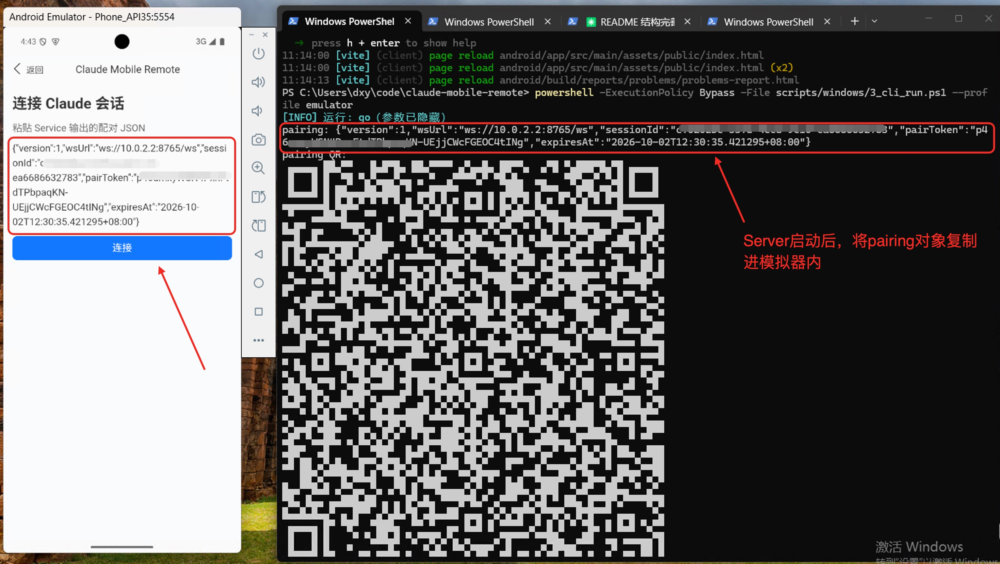

# claude-mobile-remote

> iOS 极光系统推送：下载官方 JPush 6.2.2 完整包后执行 `bash scripts/macos/ios_import_jpush.sh <解压目录>`，导入 JPush / JCore noidfa。SDK 二进制不入库。AppKey、APNs 与 PC 端配置见 [iOS 反馈修复与推送验收](docs/testing/2026-10-21-ios-feedback-result.md)。未配置时仍只有在线本地提醒。

通过独立 Standalone CLI 托管本地 Claude Session，让用户离开电脑后可在手机上继续查看和控制，并在同一工作目录新建独立会话。

## 环境准备

前提：Go ≥ 1.25 与 Node ≥ 20。新 clone 或 pull 后，从仓库根目录按序执行：

Windows PowerShell：

```powershell
powershell -ExecutionPolicy Bypass -File scripts/windows/1_install_base_tools.ps1
powershell -ExecutionPolicy Bypass -File scripts/windows/1_install_android_sdk.ps1  # 安装Android模拟器SDK
powershell -ExecutionPolicy Bypass -File scripts/windows/2_check.ps1
```

macOS：

```bash
bash scripts/macos/1_install_base_tools.sh
bash scripts/macos/1_install_android_sdk.sh   # 安装Android模拟器SDK
bash scripts/macos/2_check.sh
```

- `1_install_base_tools` 安装 Go、Node/npm 与项目依赖；
- `1_install_android_sdk` 安装 Android SDK（command-line tools、platform-tools、platform/build-tools 36），不需要可跳过；
- `2_check` 只读检查环境，不修改系统



## Server 服务端（Claude 会话服务）

Windows PowerShell：

```powershell
powershell -ExecutionPolicy Bypass -File scripts/windows/3_cli_run.ps1 --profile local     # 本机 Web 调试（默认）
powershell -ExecutionPolicy Bypass -File scripts/windows/3_cli_run.ps1 --profile emulator  # Android 模拟器内调试
powershell -ExecutionPolicy Bypass -File scripts/windows/3_cli_run.ps1 --profile device    # 真机调试
```

macOS：

```bash
bash scripts/macos/3_cli_run.sh --profile local     # 本机 Web 调试（默认）
bash scripts/macos/3_cli_run.sh --profile emulator  # Android 模拟器内调试
bash scripts/macos/3_cli_run.sh --profile device    # 真机调试
```

CLI 脚本会按 Go 包编译 `cmd/claude-mobile-remote` 的全部源码；手工启动也应使用 `go run ./cmd/claude-mobile-remote --profile local`。不要只运行 `main.go`，那样不会编译同目录的其他文件。

### 网络 profile 参数

| profile | 监听地址 | 二维码中的客户端地址 | 适用场景 |
| --- | --- | --- | --- |
| `local`（默认） | `127.0.0.1:8765` | `ws://127.0.0.1:8765/ws` | 本机浏览器调试 |
| `emulator` | `0.0.0.0:8765` | `ws://10.0.2.2:8765/ws` | Android 模拟器，`10.0.2.2` 固定解释为宿主机 |
| `device` | `0.0.0.0:8765` | 自动选一个非 loopback IPv4 | 真机；多网卡时用 `--advertise-host` 覆盖 |
| `debug` | 同 `local` | 需手动指定 | 精确控制网络参数时的调试入口 |

### 常用参数

| 参数 | 默认值 | 说明 |
| --- | --- | --- |
| `--profile` | `local` | 远程环境：`local`\|`emulator`\|`device`\|`debug` |
| `--listen` | `127.0.0.1:8765` | WebSocket 监听地址 |
| `--advertise-url` | `ws://127.0.0.1:8765/ws` | 写入二维码且客户端实际连接的地址 |
| `--advertise-host` | 空 | `device` profile 指定客户端可达 IPv4（高级参数） |
| `--pair-token-ttl` | `720h`（30 天） | 配对凭证有效期，可收紧 |
| `--allowed-origin` | `http://127.0.0.1:5173`、`http://localhost:5173` | 额外允许的浏览器 Origin，可重复；`emulator` profile 额外内置 `http://localhost` 与 `http://10.0.2.2:5173`（live 默认端口），自定义 Vite 端口时需显式传此 flag |
| `--resume` | 空 | 恢复已有会话的 session ID（UUID） |
| `--cwd` | CLI 启动目录 | 固定当前进程托管的全部 Claude 会话工作目录；手机不能指定其他路径 |
| `--permission-mode` | 空 | Claude 权限模式：`default`\|`acceptEdits`\|`plan`\|`bypassPermissions` |
| `--model` | 空 | Claude 使用的模型 |
| `--max-turns` | `0` | Claude 单次连接允许的最大 Turn 数 |
| `--max-sessions` | `4` | 同时活跃的 Claude 会话上限；已停止会话不计入 |

- 日常启动指定 `--cwd`（工作目录）和 `--permission-mode`；
- 恢复已有会话用 `--resume <sessionId>`（只能接续当前未被其他 Claude 进程占用的会话，不能接管运行中的会话）。
- 不传 `--profile` 时默认 `local`。
- `--fake-host`（脚本化假 Host）与 `--version` 用于自动化验证，一般开发用不到。

CLI 启动后先创建或恢复初始会话并显示二维码。持有任一有效配对凭证的手机完成订阅后，可点“新建会话”；新会话与旧会话并行运行，使用 CLI 启动时固定的工作目录。停止单个会话只结束其 Claude Runtime，配对入口和终态快照仍保留，可继续从该入口新建。手机删除配对记录只影响本机列表。

Standalone CLI 首次启动会在系统用户配置目录的 `claude-mobile-remote/pc-id` 保存随机 PC 编码；同一台 PC 的多个会话配对共享该编码，切换网络地址或 CLI 重启后仍可归为同一设备。首页会话按 PC 与工作目录分组；首页「设置」→「PC 管理」显示机器名、连接状态和机器编码，可二次确认移除整机本地配对，不会停止 PC 上的会话。旧版配对或未提供编码的嵌入宿主暂按连接地址分组；旧记录需重新扫描新 CLI 配对二维码才会显示机器名。

终端输入默认发往当前选中会话。`:sessions` 列表、`:use <ID 或唯一前缀>` 切换、`:new` 新建并切换、`:stop [ID]` 停止、`:pair [ID]` 重显二维码、`:quit` 退出全部托管会话。要发送以冒号开头的普通文本，输入两个冒号，例如 `::help` 将发送 `:help`。

## Web 端

Windows PowerShell：

```powershell
powershell -ExecutionPolicy Bypass -File scripts/windows/3_web_dev.ps1    # 开发（Vite dev server）
powershell -ExecutionPolicy Bypass -File scripts/windows/4_web_build.ps1  # 构建：依次 test、lint、build
```

macOS：

```bash
bash scripts/macos/3_web_dev.sh    # 开发（Vite dev server）
bash scripts/macos/4_web_build.sh  # 构建：依次 test、lint、build
```

## Android 和 iOS

### Android

| 路径 | 说明 | macOS | Windows PowerShell |
| --- | --- | --- | --- |
| `dist` | 构建 Web 并打进 App，`installDebug` 装进模拟器并自动拉起（自包含，不依赖外部服务） | `bash scripts/macos/3_android_run.sh --dist` | `powershell -ExecutionPolicy Bypass -File scripts/windows/3_android_run.ps1 -Dist` |
| `live` | 复用宿主机 Web dev server，改代码即刷新；需两个终端 | `bash scripts/macos/3_android_run.sh --live` | `powershell -ExecutionPolicy Bypass -File scripts/windows/3_android_run.ps1 -Live` |
| `build` | 只构建：Web 构建 + `cap sync` + gradlew，产出 APK 文件；不启动模拟器、不安装 | `bash scripts/macos/4_android_build.sh` | `powershell -ExecutionPolicy Bypass -File scripts/windows/4_android_build.ps1` |

**dist编译**：

Windows PowerShell：

```powershell
powershell -ExecutionPolicy Bypass -File scripts/windows/3_android_run.ps1 -Dist
```

macOS：

```bash
bash scripts/macos/3_android_run.sh --dist
```

**live 开发态调试（两个终端：Web dev server 常驻 + 装 App）**：

Windows PowerShell（终端 1 和终端 2）：

```powershell
# 终端 1：启动 Web dev server
powershell -ExecutionPolicy Bypass -File scripts/windows/3_web_dev.ps1
# 终端 2：装并自动拉起 App
powershell -ExecutionPolicy Bypass -File scripts/windows/3_android_run.ps1 -Live
```

macOS（终端 1 和终端 2）：

```bash
# 终端 1：启动 Web dev server
bash scripts/macos/3_web_dev.sh
# 终端 2：装并自动拉起 App
bash scripts/macos/3_android_run.sh --live
```

要点：

- 模拟器通过 `10.0.2.2` 访问宿主机，live 端口需与 `--port`/`-Port` 一致（默认 5173）。`emulator` profile 已放行 `http://10.0.2.2:5173`（live 默认端口），开箱即用；改端口时需给 CLI 加 `--allowed-origin http://10.0.2.2:<端口>`。
- 本机有多个 AVD 时用 `--avd`/`-Avd` 指定（如 `-Avd Phone_API35`）；只有一个可省略。可用 `emulator -list-avds` 查看。

**build（只构建，不启动模拟器、不安装）**：

Windows PowerShell：

```powershell
powershell -ExecutionPolicy Bypass -File scripts/windows/4_android_build.ps1  # debug；加 -Release 构建未签名 release
```

macOS：

```bash
bash scripts/macos/4_android_build.sh  # debug；加 --release 构建未签名 release
```

上述命令均从仓库根目录执行。构建结束后，脚本会打印 APK 的完整路径；默认 debug 包位于 `apps/mobile/android/app/build/outputs/apk/debug/ClaudeMobileRemote.apk`。需要安装到已连接的 Android 设备或模拟器时，在仓库根目录执行：

```bash
adb install -r apps/mobile/android/app/build/outputs/apk/debug/ClaudeMobileRemote.apk
```

Windows PowerShell 也使用相同的 `adb install -r` 命令。`-Release` / `--release` 的输出位于 `apps/mobile/android/app/build/outputs/apk/release/app-release-unsigned.apk`，该包未签名，需完成签名后才能安装。APK 是本地构建产物，不随 Git 仓库分发；其他机器需自行运行对应打包脚本。

### iOS（仅 macOS）

```bash
bash scripts/macos/3_ios_device.sh # 真机：准备资源并打开 Xcode
bash scripts/macos/3_ios_run.sh    # Simulator 运行
bash scripts/macos/4_ios_build.sh  # Simulator 构建
```

真机请使用 `3_ios_device.sh`：脚本自动执行依赖安装、Web 构建、iOS 同步并打开 Xcode。连接并解锁 iPhone，在 Xcode 顶部选择该手机，确认 Signing & Capabilities 的开发团队，点击 Run（▶）编译安装；首次运行按设备提示信任开发者并开启开发者模式。脚本不会自动启动模拟器。

Windows 无 Xcode/iOS Simulator 环境，改用 Android 或 Web 入口。

## 常见问题排查

- **缺少 Go 或 Node/npm**：按脚本提示用 Homebrew（macOS）或 `winget`/官方安装包（Windows）。脚本不静默修改 PATH。
- **缺少 Android SDK / adb / 模拟器 / 平台组件**：执行 `1_install_android_sdk`，再跑带 Android 选项的 `2_check`（`bash scripts/macos/2_check.sh --android` / `powershell -ExecutionPolicy Bypass -File scripts/windows/2_check.ps1 -Android`）。先用 `emulator -list-avds` 确认存在 AVD。
- **Android live 白屏或连接失败**：确认 Web dev server 仍在运行、端口与 `--port`/`-Port` 一致（默认 5173，`emulator` profile 已放行对应 Origin），并确认模拟器走 `10.0.2.2`；改端口需给 CLI 加 `--allowed-origin http://10.0.2.2:<端口>`。真机不要套用该地址，改用 CLI 的 `device` profile。
- **Android dist 仍显示旧页面**：重新执行 `3_android_run --dist`/`-Dist`，确认没有残留 live server 配置；必要时卸载旧 Debug 包重装。
- **iOS 命令失败**：仅在有 Xcode 和命令行工具的 macOS 上运行，真机使用 `3_ios_device.sh` 在 Xcode 选择 iPhone；模拟器使用 `3_ios_run.sh`。
- **脚本检查通过但 CLI 启动失败**：保留第一条错误，用 [docs/advanced-usage.md](docs/advanced-usage.md) 里的手工命令复现，区分 Go / SDK / Claude 配置 / 网络问题。

## 高级用法与排障

安全边界、debug profile、A6 局域网跨机器联调、脚本不可用时的手工诊断命令，见 [docs/advanced-usage.md](docs/advanced-usage.md)。

## 仓库

https://github.com/tea4go/claude-mobile-remote
