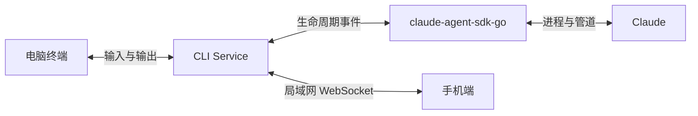

# Claude Mobile Remote 产品需求文档

## 一、产品目标

用户在电脑上通过 CLI Service 启动 Claude；离开电脑前扫描当前会话二维码，即可在手机上继续查看进度、发送消息和处理任务。

> 产品定位：远程接力当前 Claude 会话，不做全量 Claude 历史管理器。
>
> 首期交付由阶段一、阶段二组成：先搭建工程骨架，再完成单会话通信闭环。

## 二、目标效果

| 阶段 | 目标 | 效果 |
| --- | --- | --- |
| 前期 | 单会话接力 | 扫码连接当前 `sessionId`，实时查看新消息并发送简单指令 |
| 中期 | 完整会话控制 | 展示 Markdown、Thinking、Tool，支持审批、回答、取消和补充指令 |
| 中期 | 多会话 | 一台电脑可同时管理多个由 Service 托管的会话 |
| 后期 | 原生体验 | 支持扫码、语音输入、生命周期恢复和系统通知 |
| 后期 | 三端覆盖 | iOS / Android 先行，HarmonyOS NEXT 独立开发 |
| 后期 | 多机器与跨网 | 支持多 PC 切换；最后评估公网中转 |

## 三、核心流程


二维码包含局域网连接地址、`sessionId` 和临时配对凭证。手机不读取扫码前的完整对话，只接收当前任务状态、待处理事项和扫码后的新消息。

## 四、总体方案



- CLI Service 是 Claude 进程和会话状态的唯一管理者；
- `github.com/tea4go/claude-agent-sdk-go` 负责启动 Claude、接收事件和执行控制；
- 终端与手机的输入统一进入 Session Controller，避免并发写入；
- 每个 `sessionId` 对应一个逻辑消息通道；WebSocket 是网络传输协议，不使用操作系统 Pipe 连接手机；
- 首期采用局域网直连，公网中转和消息推送不阻塞核心闭环。

## 五、首期范围

### 5.1 CLI Service

- 简单行输入与流式输出，不复刻 Claude Code 完整终端 UI；
- 通过 SDK 创建并托管一个 Claude 会话；
- 获取真实 `sessionId` 后显示二维码和连接信息；
- 统一处理终端输入、手机输入和 Claude 事件；
- 支持主动停止服务，并使当前配对凭证失效。

### 5.2 移动端 Web

- 浏览器优先，先验证通信闭环；
- 扫码或输入配对链接；
- 展示连接状态、当前任务状态和扫码后的文本消息；
- 发送简单文本消息；
- 页面刷新后可重新连接并获取当前状态。

### 5.3 首期不做

- 全量历史会话与扫码前完整消息；
- 多会话、多 PC 和账号系统；
- 公网中转、后台推送和语音输入；
- 完整 Markdown、Tool UI、权限审批和复杂任务控制；
- Capacitor 真机功能和 HarmonyOS NEXT 业务实现。

## 六、技术选型

| 模块 | 技术 | 优势 | 阶段 |
| --- | --- | --- | :---: |
| CLI Service | Go | 适合进程、并发和跨平台 CLI | 1 |
| Claude 托管 | `claude-agent-sdk-go` | 已验证可覆盖生命周期、流式事件、权限与管道日志 | 1 |
| 本地通信 | WebSocket + `sessionId` 通道 | 支持事件订阅和手机双向操作 | 1 |
| 移动 Web | React + TypeScript + antd-mobile + Vite | 移动端组件成熟，浏览器调试方便 | 1 |
| iOS / Android | Capacitor | 复用 Web UI，并接入扫码、语音和推送 | 3 |
| HarmonyOS NEXT | ArkTS + ArkUI 独立开发 | 符合 HarmonyOS NEXT 原生体系 | 4 |
| 公网能力 | 后期独立设计中转服务 | 解决跨网络访问和后台通知 | 后期 |

## 七、App 研发范围


iOS / Android 共用 React Web UI 和协议层，通过 Capacitor 接入系统能力。HarmonyOS NEXT 独立开发，但必须复用同一协议与产品定义，使后续 AI 可依据前两端文档实施。

## 八、开发目录规划

```text
claude-mobile-remote/
├── cmd/                       # CLI 入口
├── internal/
│   ├── claude/                # SDK 适配与 Claude 生命周期
│   ├── session/               # 会话状态、输入串行化与事件发布
│   ├── transport/             # WebSocket、鉴权和协议
│   └── pairing/               # 二维码与临时凭证
├── apps/
│   ├── mobile-web/            # React + antd-mobile 共用 UI
│   ├── ios/                   # Capacitor iOS 工程
│   ├── android/               # Capacitor Android 工程
│   └── harmony/               # ArkTS / ArkUI 独立工程
├── docs/
│   ├── specs/                 # 总体与分阶段设计
│   ├── plans/                 # 实施计划
│   └── testing/               # 测试方案与记录
├── AGENTS.md
├── CLAUDE.md
├── HANDOFF.md
└── DECISIONS.md
```

目录按阶段创建，首期不为空壳以外的后期模块编写业务代码。

## 九、开发步骤


- 阶段一：建立 Service、移动 Web、iOS / Android 和 HarmonyOS NEXT 工程骨架；
- 阶段二：浏览器先完成 Claude、终端和手机的单会话双向通信；
- 阶段三：完善会话渲染与控制，完成 iOS / Android 原生能力和生命周期；
- 阶段四：依据统一协议和前两端研发记录，独立开发 HarmonyOS NEXT；
- 阶段五：完成三端联调、认证、上架与发布。

公网中转、系统推送、多会话和多机器在核心闭环稳定后单独排期，不反向阻塞前期设计。

## 十、首期验收标准

- CLI Service 可通过 SDK 启动并结束一个 Claude 会话；
- 可获取真实 `sessionId` 并生成有效二维码；
- 同一局域网手机浏览器可完成鉴权和连接；
- Claude 新消息可实时显示在终端和手机；
- 终端和手机均可发送消息，且不会重复或并发写乱；
- 手机连接后不返回扫码前的完整历史；
- 页面刷新或短暂断线后可恢复当前状态；
- 错误凭证无法获得会话数据，凭证不写入日志和文档。

## 十一、主要风险

| 风险 | 影响 | 控制方式 |
| --- | --- | --- |
| 双端输入并发 | 消息重复或顺序错误 | 所有输入由 Session Controller 串行处理 |
| 手机接入时缺少上下文 | 无法理解当前任务 | 返回当前状态和待处理事项，不同步完整历史 |
| 局域网环境差异 | 手机无法访问电脑 | 首期覆盖地址选择、防火墙和二维码诊断 |
| iOS / Android 生命周期 | 后台连接中断 | 原生阶段补状态恢复和系统通知 |
| HarmonyOS NEXT 成本 | 独立开发、调试和上架周期长 | 后置实施并复用统一协议与验收用例 |
