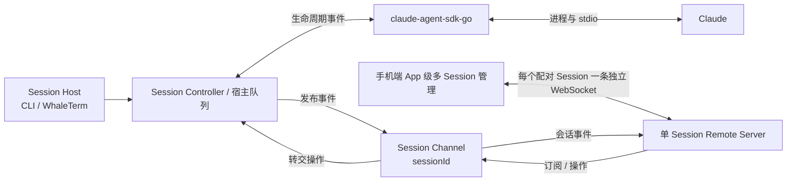
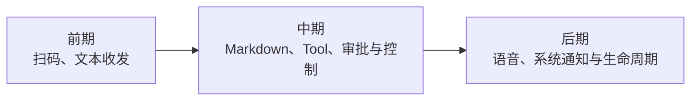
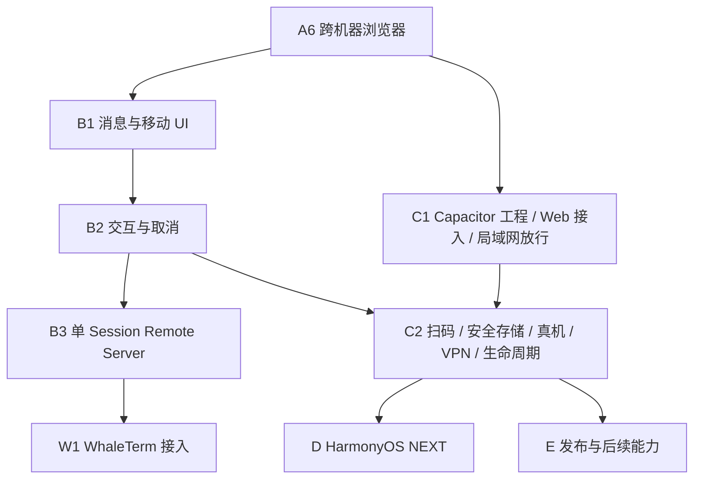

# Claude Mobile Remote 产品需求文档

> 2026-10-21 iOS 人工反馈补充：图片预览、上传不断线、工具结果正文、抽屉内部滚动、运行中停止/加载状态、PC 分层与机器名纳入本轮修复。极光 JPush 的 APNs 通知替代仅在线本地提醒作为后台/退出通知目标；SDK 与 PC 发送链路可先实现，实际送达待 AppKey/APNs/PC 凭证配置与真机验收。协议 v4 保留 v2/v3 兼容；详见 `docs/specs/2026-10-21-ios-feedback-design.md` 和 `docs/testing/2026-10-21-ios-feedback-result.md`。

## 一、产品目标

用户在电脑上通过 Standalone CLI 创建或恢复 Claude Session；离开电脑前扫描当前会话二维码，即可在手机上继续查看进度、发送消息和处理任务。新增目标：已配对手机可在该 CLI 的工作目录创建另一独立 Claude Session，旧会话继续运行；同一 CLI 进程管理多个 Session。移动端可保存、同步并切换多个已配对 Session。

> 产品定位：远程接力当前 Claude 会话，不做全量 Claude 历史管理器。
>
> 首期交付对应里程碑 A，按 A1–A6 的独立门禁推进；A6 先用局域网跨机器桌面浏览器验证网络闭环，手机/VPN 真机验收在 C2 完成。

## 二、目标效果

| 阶段 | 目标 | 效果 |
| --- | --- | --- |
| 前期 | 单会话接力 | 扫码连接当前 `sessionId`，实时查看新消息并发送简单指令 |
| 中期 | 完整会话控制 | 展示 Markdown、Thinking、Tool，支持审批、回答、取消和补充指令 |
| 中期 | 移动端多 Session | 安全保存多个已扫描 Session，在列表与单个会话详情间切换 |
| 新增 | CLI 多 Session 管理 | 已配对手机可新建独立 Session；同一 CLI 进程内的旧 Session 继续运行，多个 Session 各自隔离 |
| 中期 | 宿主复用 | 公共 Remote Server 保持单 Session 组件；Standalone CLI 另设多 Session 管理层 |
| 后期 | 原生体验 | 支持原生扫码、安全存储、语音输入、生命周期恢复和系统通知 |
| 后期 | 三端覆盖 | iOS / Android 先行，HarmonyOS NEXT 独立开发 |
| 后期 | 多机器与独立公网访问 | 通过多个配对记录切换 Session；可信 Relay 的 CLI 多 Session 映射后续单独设计 |

当前 iOS 体验反馈将列表、详情和配对页的连贯转场提前到 C2-D 真机门禁之前完成；真机需确认切换方向、滚动位置、快速往返和系统“减少动态效果”。

本轮移动端体验要求：详情状态/重连固定在标题栏，左边缘右滑返回首页；首页新增“设置”入口，设置页按 PC 稳定编码分组查看及移除本地配对。旧配对兼容连接地址分组；删除不影响 PC 会话。

C2-C 体验修订：详情抽屉缩短动画并提高面板位置；设置首页为通用列表，PC 管理为下一层且只列机器及连接状态，首页会话按 PC 和工作目录分组；新增配对入口只保留首页。新配对可携带机器名，旧配对继续按地址兼容；连接状态是本机已配对会话状态汇总，不是 PC 网络探测。

## 三、核心流程


二维码包含手机可访问的 Remote Server 地址、`sessionId` 和临时配对凭证。地址首期为 LAN/VPN 直连地址，后期可为 Relay `wss://` 地址。手机不读取扫码前的完整对话，只接收当前任务状态、待处理事项和连接后的新消息。

## 四、总体方案



该图表示单个 Session 的内部链路；Standalone CLI 多 Session 时由 CLI Manager 并行持有多套 Host/Controller/Channel，详见新增设计。

- 每个活跃 Claude Session 只有一个 Session Host 和一个 SDK Client；
- Standalone CLI 新增进程内多 Session 管理；每个 Session 仍有独立 Host、SDK Client、Controller、输入队列、Channel 和配对凭证，手机新建使用 CLI 固定的工作目录；设计见 `docs/specs/2026-09-23-standalone-cli-multi-session-design.md`；
- WhaleTerm 后续只暴露自身已持有的一个 Session，不启动额外 CLI 或第二个 SDK Client；
- `github.com/tea4go/claude-agent-sdk-go` 负责启动 Claude、接收事件和执行控制；
- Claude 的完整上下文和所有操作始终留在 PC；手机只展示 PC 推送的数据并回传操作；
- PC 与手机的输入统一进入 Session Controller 或宿主单一队列，避免并发写入；
- 每个 `sessionId` 对应一个 Session Channel；手机认证后显式订阅该 Channel；
- Session Controller 向 Channel 发布事件，Channel 将手机操作转回 Controller；
- Channel 只负责路由，不保存完整会话，也不运行 Claude；
- WebSocket 是网络传输协议，不使用操作系统 Pipe 连接手机；
- 移动端可保存多个独立配对记录；App 前台生命周期内分别连接和同步全部有效配对 Session，一次只展示一个 Session 详情；
- 手机默认先连接 VPN，再通过 WebSocket 直连 PC；不开发局域网发现或 NAT 穿透；
- 后期 Relay 与 CLI 多 Session 的隧道映射需另行设计，当前不实现；Relay 不保存 Claude 状态或历史。

## 五、首期范围

### 5.1 Standalone CLI

- 简单行输入与流式输出，不复刻 Claude Code 完整终端 UI；
- 通过 SDK 创建并托管一个 Claude 会话；
- 新会话生成 UUID 并通过 Claude CLI `--session-id` 预分配真实 `sessionId`，恢复会话使用已有 ID；SDK Connect 成功后、首个 Turn 前显示二维码和连接信息；
- 统一处理终端输入、手机输入和 Claude 事件；
- 支持主动停止服务，并使当前配对凭证失效。

### 5.2 移动端 Web

- 浏览器优先，先验证通信闭环；
- 扫码或输入配对链接；
- 展示连接状态、当前任务状态和扫码后的文本消息；
- 发送简单文本消息；
- 页面刷新后可重新连接并获取当前状态。

### 5.3 首期不做

- 全量历史会话与扫码前完整消息；
- 单进程多 Session、移动端持久多配对列表、多 PC 账号系统；
- 公网中转、后台推送和语音输入；
- 完整 Markdown、Tool UI、权限审批和复杂任务控制；
- Capacitor 真机功能和 HarmonyOS NEXT 业务实现。

## 六、技术选型

| 模块 | 技术 | 优势 | 阶段 |
| --- | --- | --- | :---: |
| CLI Service | Go | 适合进程、并发和跨平台 CLI | A1–A3 |
| Claude 托管 | `claude-agent-sdk-go` | 已验证可覆盖生命周期、流式事件、权限与管道日志 | A2 |
| 远程通信 | LAN/VPN + WebSocket + Session Channel | 按 `sessionId` 订阅和双向操作；A6 可显式使用 LAN 地址 | A4–A6 |
| 单 Session Remote Server | Go 公共组件 | 复用 Pairing、Channel 和 Transport，供 Standalone 与 WhaleTerm 使用 | B3 |
| 移动 Web | React + TypeScript + Zustand + antd-mobile + Vite | App 级多 Session 状态可精确订阅，移动端组件成熟，浏览器调试方便 | A5 / D66 |
| iOS / Android | Capacitor | 复用 Web UI，并接入扫码、语音和推送 | C |
| HarmonyOS NEXT | ArkTS + ArkUI 独立开发 | 符合 HarmonyOS NEXT 原生体系 | D |
| 公网能力 | 可信的每 CLI 单隧道 Relay | 通过出站 WSS 解决跨网络访问，不迁移 Claude 状态 | 后期 |

## 七、App 研发范围



iOS / Android 共用 React Web UI 和协议层，通过 Capacitor 接入系统能力；原生 App 使用系统安全存储保存多个已扫描 Session 的未过期 Pair Token，并在 App 前台生命周期内分别维护全部有效配对 Session 的连接与内存状态。列表和详情只是状态视图，进入或退出详情不控制连接生命周期。HarmonyOS NEXT 独立开发并使用等价安全存储与多连接状态容器，但必须复用同一套三端共用契约（通信协议、状态模型、配对负载、验收用例，见总体设计 §8.1）：所有规划在生效前已按「HarmonyOS NEXT 可独立实现」校验，协议与状态变更时必须重新核对三端可实现性。

## 八、开发目录规划

```text
claude-mobile-remote/
├── cmd/                       # CLI 入口
├── internal/
│   ├── claude/                # SDK 适配与 Claude 生命周期
│   ├── session/               # 会话状态、输入串行化与事件发布
│   ├── channel/               # sessionId 订阅与消息路由
│   ├── transport/             # WebSocket、鉴权和协议
│   └── pairing/               # 二维码与临时凭证
├── apps/
│   ├── mobile/                # React + antd-mobile 共用 UI
│   │   ├── ios/               # C1 创建的 Capacitor iOS 工程
│   │   └── android/           # C1 创建的 Capacitor Android 工程
│   └── harmony/               # D1 创建的 ArkTS / ArkUI 工程
├── docs/
│   ├── specs/                 # 总体与分阶段设计
│   ├── plans/                 # 实施计划
│   └── testing/               # 测试方案与记录
├── AGENTS.md
├── CLAUDE.md
├── HANDOFF.md
└── DECISIONS.md
```

目录按阶段创建：A1 只创建 Go 与 React/Vite 公共骨架；C1 再在 `apps/mobile/` 下创建 Capacitor iOS / Android 工程；D1 创建 HarmonyOS NEXT 工程。

## 九、开发步骤



### 9.1 里程碑 A：单会话最小闭环

| 子阶段 | 交付物 | 通过条件 |
| --- | --- | --- |
| A1 项目骨架 | Go CLI、React/Vite 与基础工程配置 | Go 与移动 Web 骨架可独立启动、构建和测试 |
| A2 SDK 托管 | 简单 CLI、真实 Claude 事件和 `sessionId` | SDK 最小用例通过 |
| A3 Session Core | Session/Turn 状态机、输入队列和 snapshot | 自动化测试通过 |
| A4 Channel 通信 | 鉴权、订阅、发布和命令回传 | 测试客户端闭环通过 |
| A5 Mobile Web | 连接、状态、文本展示和发送 | 本机浏览器通过 |
| A5.1 双端输入同步 | PC 与任意手机来源的输入正文同步到同一 Channel | 浏览器可按 request ID 正确展示并去重 |
| A5.2 首轮前配对 | 预分配真实 session ID、首轮前扫码、手机可发起首个 Turn | SDK 与浏览器闭环通过 |
| A6 跨机器浏览器联调 | Windows 机器只运行 Mobile Web，通过显式 LAN 地址控制机器 A 的 Claude | 跨机器首轮、同步、FIFO、鉴权和重连门禁通过 |

### 9.2 后续里程碑

| 里程碑 | 子阶段 |
| --- | --- |
| B 完整会话控制 | B1 消息渲染与已配对 Session 列表；B2 结构化 Thinking/Tool 展示、工具审批、AskUserQuestion 与取消；B3 单 Session Remote Server 组件化 |
| C iOS / Android | C1 Capacitor 工程、Web 接入与局域网明文放行；C2 扫码、安全存储、多配对列表、两端真机、VPN 与生命周期；C3 语音和通知 |
| W WhaleTerm | W1 为 WhaleTerm 持有的 Claude Session 分别启动独立的进程内 Remote Server，不跨 Session 路由或创建第二个 SDK Client |
| D HarmonyOS NEXT | D1 工程与协议；D2 功能迁移；D3 真机、推送与发布验证 |
| E 发布与后续能力 | E1 安全与兼容验收；E2 签名与上架；E3 可信公网 Relay 与多 PC |

每次只展开当前子阶段的实施计划；直接依赖的门禁未通过，不进入该子阶段。C1 在 A6 后可与 B 并行，C2 依赖 C1 与 B2，W1 依赖 B3。

2026-10-21 执行顺序：C 阶段优先完成 iOS，由 AI 直接实施并完成本机验证，用户统一进行最后真机验收；Android 与 HarmonyOS NEXT 原生同步在 iOS 验收后进行。C3 iOS 语音识别生成可编辑草稿，经既有文本输入链路手动发送；系统提醒针对已收到的实时事件，默认隐藏会话正文。系统挂起/关闭后的离线推送需要独立服务与平台配置，当前不承诺送达。详细范围见 `docs/specs/2026-10-21-C3-ios-voice-notifications-design.md`，验收见 `docs/testing/2026-10-21-C3-ios-result.md`。

Standalone CLI 单进程多 Session 已按 D68–D71 确认并进入实现与验证；公网中转、系统推送和云端多机器管理继续单独排期。

### 9.3 新增子阶段：Standalone CLI 多 Session

- 已配对移动端可在启动时固定的 CLI 工作目录创建全新 Claude Session，不影响已有 Session 运行；
- CLI 在同一进程内维护多个相互隔离的 Session，移动端能分别连接、查看和控制自身已配对的 Session；
- 每个活跃 Session 只有一个 Host/SDK Client，同 Session 多入口输入仍走单一队列；凭证不得跨 Session 授权；
- 任一有效已订阅 Session 凭证可请求创建；默认四个活跃会话上限，已停止会话不计入；停止后保留配对与终态入口。按共用协议在 Go、移动端和真机门禁验证。

### 9.4 移动端项目分组与会话辨认

- 已配对的 Standalone CLI 与 WhaleTerm Claude 会话均按实际工作目录 `cwd` 分组；组与组内会话按最近有意义活动从近到远排列，重连与流式增量不作为活动时间。
- 会话主标题优先使用手动名称，否则取宿主观察到的首条非空用户输入首行并保持稳定；无可用输入时用新会话/创建时间回退。列表显示最近可见内容、状态、未读和最近活动时间，返回列表可定位刚查看的会话。
- React/Capacitor 列表使用 antd-mobile `List`；HarmonyOS NEXT 实现等价列表。目录及展示信息只能在配对鉴权后返回，不新增服务器端全量 Session 列表；设计和计划见 `docs/specs/2026-09-23-mobile-project-session-list-design.md` 与同日实施计划。

## 十、首期验收标准

- Standalone CLI 可通过 SDK 启动并结束一个 Claude 会话；
- 新会话可预分配真实 `sessionId`，恢复会话可复用已有 ID，并在首个 Turn 前生成有效二维码；
- PC 或已配对手机均可发送第一条真实消息来启动 Claude 会话；
- Windows 机器 B 只运行 Mobile Web，即可通过显式 LAN 地址完成鉴权并连接机器 A；
- Claude 新消息可实时显示在机器 A 和机器 B 的浏览器；
- PC、机器 B 及多个浏览器均可发送消息，且不会重复或并发写乱；
- 客户端连接后不返回扫码前的完整历史；
- 页面刷新或短暂断线后可恢复当前状态；
- 错误凭证无法获得会话数据，凭证不写入日志和文档。

手机、VPN、原生扫码、安全存储和移动生命周期不属于 A6 通过结论，在 C2 使用真机验收。

## 十一、主要风险

| 风险 | 影响 | 控制方式 |
| --- | --- | --- |
| 双端输入并发 | 消息重复或顺序错误 | 所有输入由 Session Controller 串行处理 |
| iOS / Android 生命周期 | 后台连接中断 | 原生阶段补状态恢复和系统通知 |
| 配对凭证泄露或本地文件泄露 | 未过期 Token 被滥用 | Pair Token 仍按 `sessionId` 精确绑定并在服务端校验；PC 侧 pairing 文件仅当前用户可读写，过期后失效并在下次启动时清理，需提前失效时删除该文件；原生端使用系统安全存储，浏览器不写 localStorage |
| HarmonyOS NEXT 成本 | 独立开发、调试和上架周期长 | 后置实施并复用统一协议与验收用例 |
| WebView 套壳兼容（C1） | 明文 WebSocket 被 iOS ATS / Android cleartext 策略拦截，壳子只能显示空布局 | C1 只放行局域网明文（D44）：iOS Info.plist 使用 `NSAllowsLocalNetworking` 并提供 `NSLocalNetworkUsageDescription`（iOS 14+ 本地网络权限），Android 使用 cleartext 放行；不使用 `NSAllowsArbitraryLoads`，不放行公网明文；移动 Web 路由自 A5 起约束为 hash / 内存路由，规避自定义 scheme 路径解析问题 |
| 共用契约被单端污染 | 前两端收尾后 HarmonyOS NEXT 无法实现，被迫换方案 | 协议与状态变更强制核对三端可实现性（硬约束 11 / 设计 §8.1），核对结论记入 DECISIONS |
| 可信 Relay 可见协议流量 | 公网中转基础设施可接触会话内容 | Relay 不存储内容并与 Pair Token 权限分离；若未来要求不可信中转，再独立设计端到端加密 |

### 移动端附件补全（2026-10-21）

图片、拍照与文件必须真正传到已配对 PC；支持预览、追加/移除、仅附件发送及文字组合。单次最多 4 项，每项 4 MiB，总计 8 MiB。服务端确认受理后清空，拒绝或结果未知时保留当前页面草稿，不自动重发。附件在 PC 私有临时缓存中保存，通过原输入队列交给 Claude 按已有工具权限读取；满 7 天在后续上传时清理，不属于手机离线历史。iOS 优先；真机拍照、授权拒绝与实际模型读取需用户验收。契约见 `docs/specs/2026-10-21-mobile-attachments-design.md`。

### iOS 人工测试反馈（2026-10-21）

C-ios-result.md 指定：消息内图片预览、上传不断线、工具结果正文、限高滚动抽屉、运行中停止替换发送及加载指示、PC/项目/会话分层和系统机器名。新增极光 JPush 的 APNs 系统通知，替代仅在线本地提醒作为后台/退出后的实现目标；保留本地提醒作为未配置时的有限降级。协议 v4 对工具结果下发最多 16 KiB 文本并标明截断；v2/v3 兼容。SDK/发送链路可先实现，AppKey、APNs 签名/极光证书与实际送达需要真机验收；公网会话恢复待 Relay。
