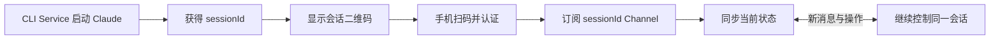
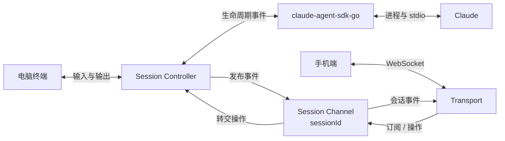
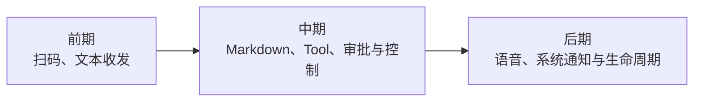
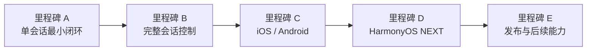

# Claude Mobile Remote 产品需求文档

## 一、产品目标

用户在电脑上通过 CLI Service 启动 Claude；离开电脑前扫描当前会话二维码，即可在手机上继续查看进度、发送消息和处理任务。

> 产品定位：远程接力当前 Claude 会话，不做全量 Claude 历史管理器。
>
> 首期交付对应里程碑 A，按 A1–A6 六个可独立验证的子阶段推进。

## 二、目标效果

| 阶段 | 目标 | 效果 |
| --- | --- | --- |
| 前期 | 单会话接力 | 扫码连接当前 `sessionId`，实时查看新消息并发送简单指令 |
| 中期 | 完整会话控制 | 展示 Markdown、Thinking、Tool，支持审批、回答、取消和补充指令 |
| 中期 | 多会话 | 一台电脑可同时管理多个由 Service 托管的会话 |
| 后期 | 原生体验 | 支持扫码、语音输入、生命周期恢复和系统通知 |
| 后期 | 三端覆盖 | iOS / Android 先行，HarmonyOS NEXT 独立开发 |
| 后期 | 多机器与独立公网访问 | 支持多 PC 切换；最后评估脱离 VPN 的公网中转 |

## 三、核心流程



二维码包含手机可通过 VPN 访问的 PC Service 地址、`sessionId` 和临时配对凭证。手机不读取扫码前的完整对话，只接收当前任务状态、待处理事项和扫码后的新消息。

## 四、总体方案



- CLI Service 是 Claude 进程和会话状态的唯一管理者；
- `github.com/tea4go/claude-agent-sdk-go` 负责启动 Claude、接收事件和执行控制；
- Claude 的完整上下文和所有操作始终留在 PC；手机只展示 PC 推送的数据并回传操作；
- 终端与手机的输入统一进入 Session Controller，避免并发写入；
- 每个 `sessionId` 对应一个 Session Channel；手机认证后显式订阅该 Channel；
- Session Controller 向 Channel 发布事件，Channel 将手机操作转回 Controller；
- Channel 只负责路由，不保存完整会话，也不运行 Claude；
- WebSocket 是网络传输协议，不使用操作系统 Pipe 连接手机；
- 手机默认先连接 VPN，再通过 WebSocket 直连 PC Service；
- 首期不处理局域网发现、NAT 穿透和网络差异，公网中转与消息推送不阻塞核心闭环。

## 五、首期范围

### 5.1 CLI Service

- 简单行输入与流式输出，不复刻 Claude Code 完整终端 UI；
- 通过 SDK 创建并托管一个 Claude 会话；
- 获取真实 `sessionId` 后显示二维码和连接信息；
- 统一处理终端输入、手机输入和 Claude 事件；
- 支持主动停止服务，并使当前配对凭证失效。

### 5.2 移动端 Web

- 浏览器优先，先验证通信闭环；
- 扫码或输入配对链接；
- 展示连接状态、当前任务状态和扫码后的文本消息；
- 发送简单文本消息；
- 页面刷新后可重新连接并获取当前状态。

### 5.3 首期不做

- 全量历史会话与扫码前完整消息；
- 多会话、多 PC 和账号系统；
- 公网中转、后台推送和语音输入；
- 完整 Markdown、Tool UI、权限审批和复杂任务控制；
- Capacitor 真机功能和 HarmonyOS NEXT 业务实现。

## 六、技术选型

| 模块 | 技术 | 优势 | 阶段 |
| --- | --- | --- | :---: |
| CLI Service | Go | 适合进程、并发和跨平台 CLI | A1–A3 |
| Claude 托管 | `claude-agent-sdk-go` | 已验证可覆盖生命周期、流式事件、权限与管道日志 | A2 |
| 远程通信 | VPN + WebSocket + Session Channel | 无需公网中转即可按 `sessionId` 订阅和双向操作 | A4 |
| 移动 Web | React + TypeScript + antd-mobile + Vite | 移动端组件成熟，浏览器调试方便 | A5 |
| iOS / Android | Capacitor | 复用 Web UI，并接入扫码、语音和推送 | C |
| HarmonyOS NEXT | ArkTS + ArkUI 独立开发 | 符合 HarmonyOS NEXT 原生体系 | D |
| 公网能力 | 后期独立设计中转服务 | 解决跨网络访问和后台通知 | 后期 |

## 七、App 研发范围



iOS / Android 共用 React Web UI 和协议层，通过 Capacitor 接入系统能力。HarmonyOS NEXT 独立开发，但必须复用同一套三端共用契约（通信协议、状态模型、配对负载、验收用例，见总体设计 §8.1）：所有规划在生效前已按「HarmonyOS NEXT 可独立实现」校验，协议与状态变更时必须重新核对三端可实现性，防止前两端收尾后才发现不兼容。

## 八、开发目录规划

```text
claude-mobile-remote/
├── cmd/                       # CLI 入口
├── internal/
│   ├── claude/                # SDK 适配与 Claude 生命周期
│   ├── session/               # 会话状态、输入串行化与事件发布
│   ├── channel/               # sessionId 订阅与消息路由
│   ├── transport/             # WebSocket、鉴权和协议
│   └── pairing/               # 二维码与临时凭证
├── apps/
│   ├── mobile/                # React + antd-mobile 共用 UI
│   │   ├── ios/               # C1 创建的 Capacitor iOS 工程
│   │   └── android/           # C1 创建的 Capacitor Android 工程
│   └── harmony/               # D1 创建的 ArkTS / ArkUI 工程
├── docs/
│   ├── specs/                 # 总体与分阶段设计
│   ├── plans/                 # 实施计划
│   └── testing/               # 测试方案与记录
├── AGENTS.md
├── CLAUDE.md
├── HANDOFF.md
└── DECISIONS.md
```

目录按阶段创建：A1 只创建 Go 与 React/Vite 公共骨架；C1 再在 `apps/mobile/` 下创建 Capacitor iOS / Android 工程；D1 创建 HarmonyOS NEXT 工程。

## 九、开发步骤



### 9.1 里程碑 A：单会话最小闭环

| 子阶段 | 交付物 | 通过条件 |
| --- | --- | --- |
| A1 项目骨架 | Go CLI、React/Vite 与基础工程配置 | Go 与移动 Web 骨架可独立启动、构建和测试 |
| A2 SDK 托管 | 简单 CLI、真实 Claude 事件和 `sessionId` | SDK 最小用例通过 |
| A3 Session Core | Session/Turn 状态机、输入队列和 snapshot | 自动化测试通过 |
| A4 Channel 通信 | 鉴权、订阅、发布和命令回传 | 测试客户端闭环通过 |
| A5 Mobile Web | 连接、状态、文本展示和发送 | 本机浏览器通过 |
| A6 VPN 联调 | 手机连接 VPN 后扫码控制真实 Claude | 首期验收用例通过 |

### 9.2 后续里程碑

| 里程碑 | 子阶段 |
| --- | --- |
| B 完整会话控制 | B1 消息渲染；B2 审批与任务控制；B3 多会话；B4 重连与状态恢复 |
| C iOS / Android | C1 Capacitor 与扫码；C2 两端真机联调；C3 语音、通知与生命周期 |
| D HarmonyOS NEXT | D1 工程与协议；D2 功能迁移；D3 真机、推送与发布验证 |
| E 发布与后续能力 | E1 安全与兼容验收；E2 签名与上架；E3 多 PC 与公网中转 |

每次只展开当前子阶段的实施计划；前一子阶段门禁未通过，不进入下一子阶段。

公网中转、系统推送、多会话和多机器在核心闭环稳定后单独排期，不反向阻塞前期设计。

## 十、首期验收标准

- CLI Service 可通过 SDK 启动并结束一个 Claude 会话；
- 可获取真实 `sessionId` 并生成有效二维码；
- 手机连接 VPN 后，浏览器可完成鉴权和连接；
- Claude 新消息可实时显示在终端和手机；
- 终端和手机均可发送消息，且不会重复或并发写乱；
- 手机连接后不返回扫码前的完整历史；
- 页面刷新或短暂断线后可恢复当前状态；
- 错误凭证无法获得会话数据，凭证不写入日志和文档。

## 十一、主要风险

| 风险 | 影响 | 控制方式 |
| --- | --- | --- |
| 双端输入并发 | 消息重复或顺序错误 | 所有输入由 Session Controller 串行处理 |
| iOS / Android 生命周期 | 后台连接中断 | 原生阶段补状态恢复和系统通知 |
| HarmonyOS NEXT 成本 | 独立开发、调试和上架周期长 | 后置实施并复用统一协议与验收用例 |
| WebView 套壳兼容（C1） | 明文 WebSocket 被 iOS ATS / Android cleartext 策略拦截 | C1 增加平台配置：iOS Info.plist ATS 例外，Android Manifest `usesCleartextTraffic`；移动 Web 路由自 A5 起约束为 hash / 内存路由，规避自定义 scheme 路径解析问题 |
| 共用契约被单端污染 | 前两端收尾后 HarmonyOS NEXT 无法实现，被迫换方案 | 协议与状态变更强制核对三端可实现性（硬约束 11 / 设计 §8.1），核对结论记入 DECISIONS |
