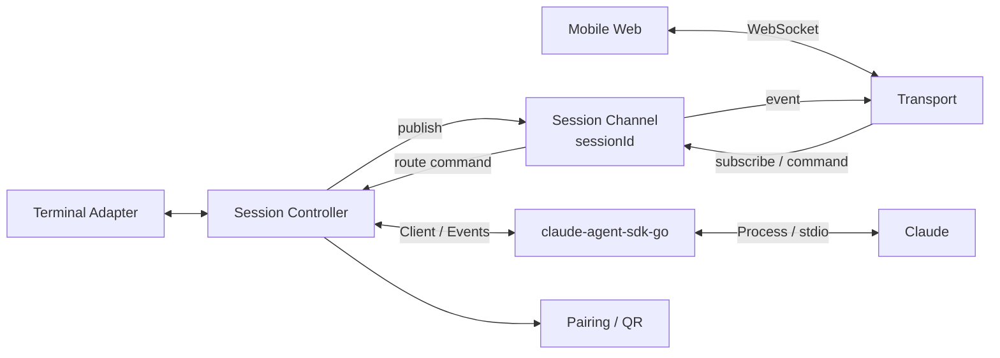
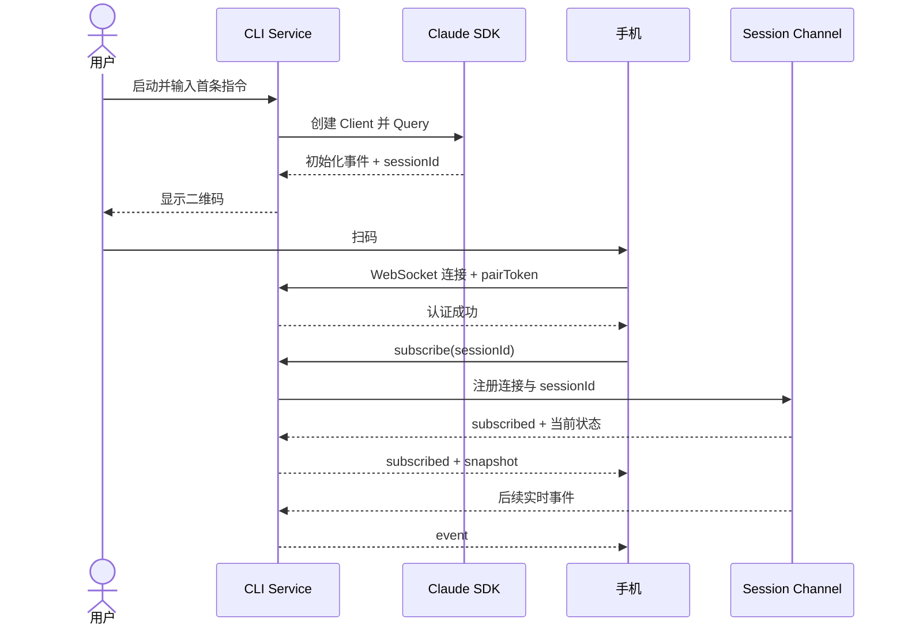
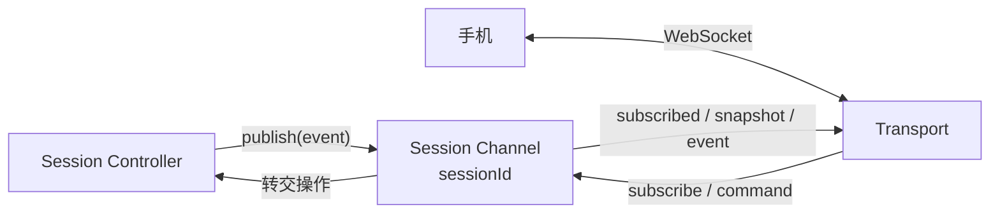

# Claude Mobile Remote 总体设计

- 日期：2026-08-21
- 状态：已确认，待 A1 实施计划
- 对应需求：`REQUIREMENTS.md`

## 1. 设计目标

建立独立 CLI Service，通过 `claude-agent-sdk-go` 托管 Claude。首期让已连接 VPN 的手机浏览器扫描当前会话二维码后，直连 PC Service，实时接收新消息并发送简单指令。

本设计同时保留多会话、原生 App、HarmonyOS NEXT 和公网中转的扩展边界，但不提前实现。

## 2. 架构



### 2.1 组件职责

| 组件 | 职责 | 不负责 |
| --- | --- | --- |
| Terminal Adapter | 简单行输入、流式文本输出、二维码提示 | 完整 TUI、会话状态管理 |
| Session Controller | 持有当前 session、串行输入、状态快照、事件排序 | 网络连接、UI 渲染 |
| Claude Adapter | 封装 SDK Client、事件、取消、权限和恢复 | 手机协议、业务页面 |
| Session Channel | 按 `sessionId` 管理订阅、发布事件和路由操作 | 保存完整会话、运行 Claude |
| Transport | WebSocket、鉴权、消息 envelope、连接状态 | Claude 生命周期 |
| Pairing | 临时凭证、二维码内容和撤销 | 长期账号与设备中心 |
| Mobile Web | 扫码连接、状态展示、文本收发 | 直接访问 Claude 或本地历史文件 |

Claude 的完整上下文、会话状态和操作执行始终留在 PC。手机只是远程界面，不保存或重建 Claude 上下文。

## 3. 会话模型

首期进程内只允许一个 `SessionController` 管理一个 Claude session。

```text
Session
├── sessionId          Claude 返回的真实会话 ID
├── status             starting / ready / stopped / failed
├── seq                单调递增事件序号
├── turn
│   ├── status         idle / running / waiting / completed / cancelled / failed
│   ├── currentMessage 当前正在生成的消息
│   └── pendingAction  待审批或待回答事项，首期为空
├── clients            已连接终端与手机
└── inputQueue         终端和手机共用的串行输入队列
```

`sessionId` 由 SDK/Claude 产生。Service 在收到包含真实 `session_id` 的初始化事件后生成二维码，不用应用自造 ID 冒充 Claude session。

`ResultMessage` 只结束当前 Turn：Turn 进入 `completed`，Session 回到 `ready` 并继续接收下一条消息。只有 Session 停止或失败后才拒绝新操作。

## 4. 数据流

### 4.1 启动与扫码



### 4.2 Channel 订阅



- 每个 Claude `sessionId` 对应一个逻辑 Channel；
- 手机必须先通过 Transport 鉴权，再显式发送 `subscribe`；
- Channel Registry 维护 `sessionId → subscribers` 映射；
- Session Controller 是事件发布者，也是手机操作的最终执行者；
- 手机订阅成功后，由 Channel 经 Transport 实时推送事件；
- Channel 只做内存路由，不保存 transcript，手机也不从 Channel 读取历史。

### 4.3 双端输入

终端和手机都不能直接调用 SDK。输入先进入 Session Controller：

1. 校验目标 `sessionId` 和连接权限；
2. 分配 request ID；
3. 写入统一队列；
4. Controller 根据当前 turn 状态执行或排队；
5. SDK 结果转换为统一事件，发布到对应 Session Channel。

首期保证顺序正确，不承诺复杂的中途 steer 语义；相关能力在完整控制阶段结合 SDK 行为单独设计。

里程碑 A 的手机端只发送文本消息。审批、回答和取消在 B2 接入相同命令链路，届时提交目标 `sessionId`、操作内容和必要的 `actionId`，仍由 Session Controller 根据 PC 上的当前状态校验并执行。

### 4.4 手机显示与恢复

PC 始终持有完整 Claude 上下文。手机首次连接、刷新或短暂断线后，只同步界面所需状态：

- 当前连接和会话状态；
- 当前正在生成的消息；
- 当前待处理操作；
- 配对完成后的新增事件。

snapshot 只用于保持手机界面与 PC 当前状态一致，不用于重建 Claude 上下文，也不读取或下发扫码前的完整 JSONL/transcript。

## 5. 通信协议原则

首期使用 JSON envelope：

```json
{
  "version": 1,
  "type": "event",
  "requestId": "optional-request-id",
  "sessionId": "claude-session-id",
  "seq": 1,
  "payload": {}
}
```

基础消息类型：

- `hello` / `hello_ack`：配对认证；
- `subscribe` / `subscribed`：订阅 `sessionId` Channel 并返回当前状态；
- `unsubscribe`：取消当前 Channel 订阅；
- `snapshot`：当前状态；
- `event`：Claude 新事件；
- `command` / `command_result`：手机操作及结果；
- `ping` / `pong`：为后续心跳预留；
- `error`：可诊断错误。

协议层只依赖 session 领域接口，不依赖 WebSocket 实现细节，以便后期增加公网 relay。

同一连接认证成功后仍不能直接接收事件；只有成功订阅存在且授权的 `sessionId` 后，才加入该 Channel 的订阅者集合。

## 6. 配对与安全

二维码负载至少包含：

- 协议版本；
- 手机可通过 VPN 访问的 PC Service 地址；
- `sessionId`；
- 随机短期 `pairToken`。

安全规则：

- Service 由用户显式启动；
- token 使用安全随机数，只与当前 Service/session 生命周期关联；
- 停止服务或撤销配对后立即失效；
- token 不出现在普通日志、文档和测试快照；
- 认证完成前不返回任何会话数据；
- 首期以 VPN 网络为传输边界，应用层仍必须完成 session 与 token 鉴权；公网阶段重新设计 TLS 和身份体系。

## 7. 错误与恢复

| 场景 | 首期行为 |
| --- | --- |
| SDK 启动失败 | CLI 输出可诊断错误，不启动配对服务 |
| 尚未取得 sessionId | 不显示可扫描二维码 |
| 手机凭证错误 | 拒绝连接，不返回状态 |
| Channel 不存在或无权订阅 | 返回错误，不加入订阅者集合 |
| 手机短暂断线 | 重新鉴权后返回最新 snapshot |
| 终端与手机同时输入 | Channel 将操作转给同一输入队列，按接收顺序处理 |
| 当前 Turn 完成 | 广播 Turn 结果，Session 回到 `ready` 并接受下一条消息 |
| Session 失败或停止 | 广播最终状态，拒绝新的执行命令 |
| Service 停止 | 关闭连接、撤销 token，并结束其托管的 Claude 生命周期 |

首期重连采用“重新获取最新状态”，不实现完整事件持久化和跨进程补发。事件 `seq` 从首期保留，为后期精确恢复预留。

## 8. 扩展边界

- **多会话**：把单个 Controller 扩展为以 `sessionId` 索引的 Registry；
- **多手机**：Transport 已按订阅者广播，后续增加连接策略；
- **Capacitor**：复用 Mobile Web、协议客户端和状态模型，只替换 NativeBridge；
- **HarmonyOS NEXT**：复用协议、产品状态和验收用例，ArkTS/ArkUI 独立实现 UI；
- **公网 relay**：保持 Client ↔ Transport 协议语义，新增出站连接与路由，不把 Claude 状态迁入云端；
- **推送**：只携带提醒和定位信息，重新打开 App 后仍以 Service 状态为准。

## 9. 测试策略

### 9.1 分层测试

- Claude Adapter：使用 SDK fake/fixture 验证事件转换、错误和取消；
- Session Controller：并发输入、顺序、Session/Turn 状态转换和 snapshot；
- Session Channel：订阅、取消订阅、事件广播、无权订阅和 session 隔离；
- Transport：鉴权、session 隔离、消息关联和断线；
- Mobile Web：连接状态、事件渲染和消息发送；
- 端到端：真实 Claude + 两个浏览器/终端入口。

### 9.2 首期门禁

1. A1：Go CLI 与 React/Vite 骨架可独立启动、构建和测试；
2. A2：SDK 最小托管和真实 `sessionId` 验证通过；
3. A3：Session Controller 自动化测试通过；
4. A4：Channel 鉴权、订阅、发布和命令回传通过；
5. A5：本机浏览器闭环通过；
6. A6：VPN 内手机、断线、错 token 和双端输入验证通过。

前一门禁未通过，不进入下一层或原生 App 开发。

## 10. 计划目录

```text
cmd/claude-mobile-remote/
internal/claude/
internal/session/
internal/channel/
internal/transport/
internal/pairing/
apps/mobile/
apps/mobile/ios/       # C1 创建
apps/mobile/android/   # C1 创建
apps/harmony/          # D1 创建
docs/specs/
docs/plans/
docs/testing/
```

## 11. 下一步

总体设计已经确认。下一步只编写 A1 项目骨架实施计划；A1 门禁通过并更新交接文档后，再编写 A2，后续子阶段遵循相同节奏。
