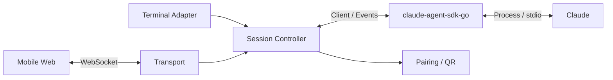
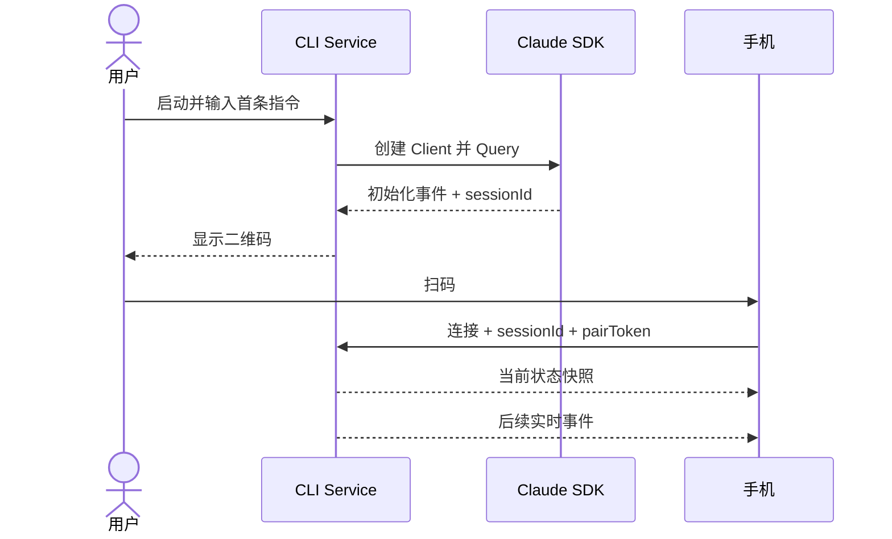

# Claude Mobile Remote 总体设计

- 日期：2026-08-21
- 状态：待用户复核
- 对应需求：`REQUIREMENTS.md`

## 1. 设计目标

建立独立 CLI Service，通过 `claude-agent-sdk-go` 托管 Claude。首期让同一局域网内的手机浏览器扫描当前会话二维码后，实时接收新消息并发送简单指令。

本设计同时保留多会话、原生 App、HarmonyOS NEXT 和公网中转的扩展边界，但不提前实现。

## 2. 架构



### 2.1 组件职责

| 组件 | 职责 | 不负责 |
| --- | --- | --- |
| Terminal Adapter | 简单行输入、流式文本输出、二维码提示 | 完整 TUI、会话状态管理 |
| Session Controller | 持有当前 session、串行输入、状态快照、事件排序 | 网络连接、UI 渲染 |
| Claude Adapter | 封装 SDK Client、事件、取消、权限和恢复 | 手机协议、业务页面 |
| Transport | WebSocket、鉴权、消息 envelope、连接状态 | Claude 生命周期 |
| Pairing | 临时凭证、二维码内容和撤销 | 长期账号与设备中心 |
| Mobile Web | 扫码连接、状态展示、文本收发 | 直接访问 Claude 或本地历史文件 |

## 3. 会话模型

首期进程内只允许一个 `SessionController` 管理一个 Claude session。

```text
Session
├── sessionId          Claude 返回的真实会话 ID
├── status             starting / running / waiting / completed / failed / stopped
├── seq                单调递增事件序号
├── currentTurn        当前任务摘要与阶段
├── pendingAction      待审批或待回答事项，首期可为空
├── clients            已连接终端与手机
└── inputQueue         终端和手机共用的串行输入队列
```

`sessionId` 由 SDK/Claude 产生。Service 在收到包含真实 `session_id` 的初始化事件后生成二维码，不用应用自造 ID 冒充 Claude session。

## 4. 数据流

### 4.1 启动与扫码



### 4.2 双端输入

终端和手机都不能直接调用 SDK。输入先进入 Session Controller：

1. 校验目标 `sessionId` 和连接权限；
2. 分配 request ID；
3. 写入统一队列；
4. Controller 根据当前 turn 状态执行或排队；
5. SDK 结果转换为统一事件并广播给所有订阅端。

首期保证顺序正确，不承诺复杂的中途 steer 语义；相关能力在完整控制阶段结合 SDK 行为单独设计。

### 4.3 新连接状态

新手机只收到：

- 当前连接和会话状态；
- 当前正在生成的文本或任务摘要；
- 当前待处理操作；
- 配对完成后的新增事件。

不读取或下发扫码前的完整 JSONL/transcript。

## 5. 通信协议原则

首期使用 JSON envelope：

```json
{
  "version": 1,
  "type": "event",
  "requestId": "optional-request-id",
  "sessionId": "claude-session-id",
  "seq": 1,
  "payload": {}
}
```

基础消息类型：

- `hello` / `hello_ack`：配对认证；
- `snapshot`：当前状态；
- `event`：Claude 新事件；
- `command` / `command_result`：手机操作及结果；
- `ping` / `pong`：为后续心跳预留；
- `error`：可诊断错误。

协议层只依赖 session 领域接口，不依赖 WebSocket 实现细节，以便后期增加公网 relay。

## 6. 配对与安全

二维码负载至少包含：

- 协议版本；
- Service 局域网地址；
- `sessionId`；
- 随机短期 `pairToken`。

安全规则：

- Service 由用户显式启动；
- token 使用安全随机数，只与当前 Service/session 生命周期关联；
- 停止服务或撤销配对后立即失效；
- token 不出现在普通日志、文档和测试快照；
- 认证完成前不返回任何会话数据；
- 首期明确局域网信任边界，公网阶段重新设计 TLS 和身份体系。

## 7. 错误与恢复

| 场景 | 首期行为 |
| --- | --- |
| SDK 启动失败 | CLI 输出可诊断错误，不启动配对服务 |
| 尚未取得 sessionId | 不显示可扫描二维码 |
| 手机凭证错误 | 拒绝连接，不返回状态 |
| 手机短暂断线 | 重新鉴权后返回最新 snapshot |
| 终端与手机同时输入 | 进入同一队列，按接收顺序处理 |
| Claude 结束 | 广播最终状态，拒绝新的执行命令 |
| Service 停止 | 关闭连接、撤销 token，并结束其托管的 Claude 生命周期 |

首期重连采用“重新获取最新状态”，不实现完整事件持久化和跨进程补发。事件 `seq` 从首期保留，为后期精确恢复预留。

## 8. 扩展边界

- **多会话**：把单个 Controller 扩展为以 `sessionId` 索引的 Registry；
- **多手机**：Transport 已按订阅者广播，后续增加连接策略；
- **Capacitor**：复用 Mobile Web、协议客户端和状态模型，只替换 NativeBridge；
- **HarmonyOS NEXT**：复用协议、产品状态和验收用例，ArkTS/ArkUI 独立实现 UI；
- **公网 relay**：保持 Client ↔ Transport 协议语义，新增出站连接与路由，不把 Claude 状态迁入云端；
- **推送**：只携带提醒和定位信息，重新打开 App 后仍以 Service 状态为准。

## 9. 测试策略

### 9.1 分层测试

- Claude Adapter：使用 SDK fake/fixture 验证事件转换、错误和取消；
- Session Controller：并发输入、顺序、状态转换和 snapshot；
- Transport：鉴权、session 隔离、消息关联和断线；
- Mobile Web：连接状态、事件渲染和消息发送；
- 端到端：真实 Claude + 两个浏览器/终端入口。

### 9.2 首期门禁

1. SDK 最小托管验证通过；
2. 单 Session Controller 自动化测试通过；
3. 本机浏览器闭环通过；
4. 同一局域网手机浏览器闭环通过；
5. 断线、错 token 和双端同时输入验证通过。

前一门禁未通过，不进入下一层或原生 App 开发。

## 10. 计划目录

```text
cmd/claude-mobile-remote/
internal/claude/
internal/session/
internal/transport/
internal/pairing/
apps/mobile-web/
apps/ios/
apps/android/
apps/harmony/
docs/specs/
docs/plans/
docs/testing/
```

## 11. 下一步

用户复核本设计后，编写阶段一/二实施计划。计划应先完成 SDK 最小验证和协议闭环，再创建原生能力，不在首期引入公网中转或完整历史。
