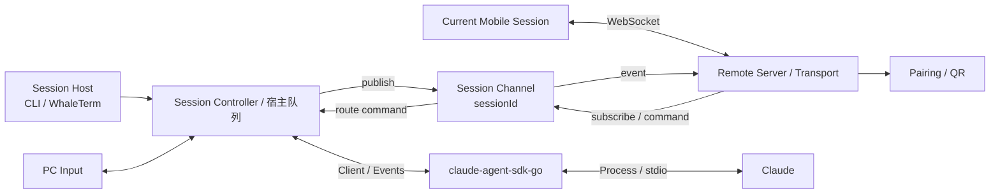
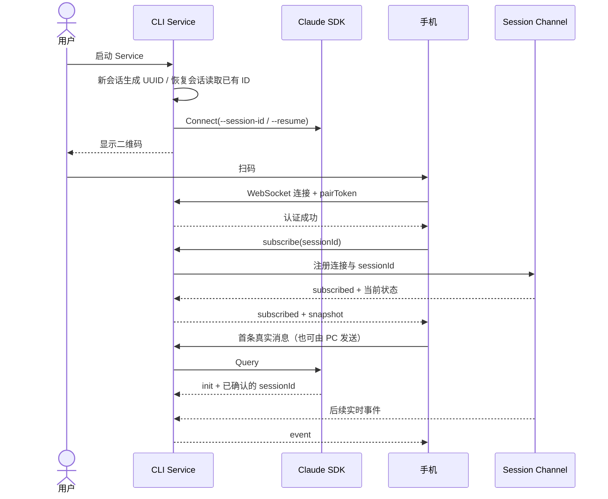
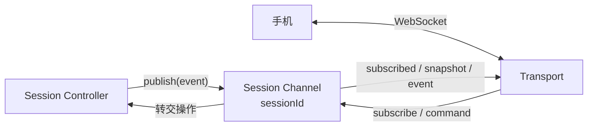

# Claude Mobile Remote 总体设计

> 2026-10-21 修订：iOS 人工反馈扩展见 `2026-10-21-ios-feedback-design.md`。工具结果使用协议 v4 的有界纯文本，PC 对 v2/v3 剥离扩展，新手机可协商降级。极光系统通知由 PC 独立订阅与出站 REST 请求驱动，不依赖手机 WebSocket 常驻；平台凭证及实际送达仍需真机验收。配对/唯一 Host/FIFO 边界不变。

- 日期：2026-08-21
- 修订：2026-08-26
- 状态：总体设计已确认；A1–A5.2 已完成，后续路线见 `2026-08-25-simplified-roadmap-and-session-remote-design.md`
- 对应需求：`REQUIREMENTS.md`

> 2026-10-26 修订：D93增加协议v5当前轮次进度与安全宿主诊断，兼容v2–v4，三端纯JSON契约及旧端同seq降级见 `2026-10-26-session-progress-design.md`。

## 1. 设计目标

里程碑 A 建立独立 Standalone CLI，通过 `claude-agent-sdk-go` 托管一个 Claude Session，并用单 Session Remote Server 暴露当前 `sessionId`。后续按 D68 增加 CLI 进程内多 Session 管理；新增设计见 `2026-09-23-standalone-cli-multi-session-design.md`。里程碑 A 的浏览器双向文本闭环和跨机器 LAN 门禁保持历史验收边界。

公共单 Session Remote Server 不改变每 Session 唯一 Host 和 SDK Client 的所有权边界；移动端可保存多个独立配对记录。原“每 CLI 一条 Relay 隧道”设计尚未适配 CLI 多 Session，后续单独修订。

## 2. 架构



### 2.1 组件职责

| 组件 | 职责 | 不负责 |
| --- | --- | --- |
| Session Host | 持有唯一 SDK Client、Claude Session 和输入队列 | 第二个活跃 Client、跨进程 Session 管理 |
| Terminal Adapter | 简单行输入、流式文本输出、二维码提示 | 完整 TUI、会话状态管理 |
| Session Controller | 持有当前 session、串行输入、状态快照、事件排序 | 网络连接、UI 渲染 |
| Claude Adapter | 封装 SDK Client、事件、取消、权限和恢复 | 手机协议、业务页面 |
| Session Channel | 按 `sessionId` 管理订阅、发布事件和路由操作 | 保存完整会话、运行 Claude |
| Transport | WebSocket、鉴权、消息 envelope、连接状态 | Claude 生命周期 |
| Pairing | 临时凭证、二维码内容和撤销 | 长期账号与设备中心 |
| Mobile Client | 已配对列表、各 Session 独立连接与内存状态、当前详情展示和操作 | 直接访问 Claude、重建上下文或服务器端 Session 管理 |

Claude 的完整上下文、会话状态和操作执行始终留在 PC。Remote Server 不直接使用 SDK；手机只保存配对记录和界面状态，不保存或重建 Claude 上下文。

## 3. 会话模型

里程碑 A/B 的 Standalone CLI 只有一个 `SessionController` 管理一个 Claude Session；这一进程级限制已由 D68 替代。新增 CLI Runtime Manager 可同时持有多个彼此独立的 Session Controller，每个 Controller 仍只管理一个 Claude Session，并由一个 Host 和一个 SDK Client 持有。现有单 Session Remote Server 公共组件仍保持原职责；具体 CLI 组合方案见新增设计。

```text
Session
├── sessionId          新会话预分配或恢复会话已有的真实 Claude 会话 ID
├── status             starting / ready / stopped / failed
├── seq                单调递增事件序号
├── turn
│   ├── status         idle / running / waiting / completed / cancelled / failed
│   ├── currentMessage 当前正在生成的消息
│   └── pendingAction  待审批或待回答事项，首期为空
├── clients            已连接 PC 入口与手机
└── inputQueue         PC 和手机共用的串行输入队列
```

新会话的 `sessionId` 由 Standalone CLI 生成合法 UUID，并通过 Claude CLI `--session-id` 指定为该会话的真实 ID；恢复会话使用已有真实 ID 和 `--resume`。SDK Connect 成功后即可生成二维码，首个真实 Query 的 init 事件必须返回相同 ID并完成确认。Session Host 不使用未交给 Claude 的本地替代 ID冒充 Claude Session。

`ResultMessage` 只结束当前 Turn：Turn 进入 `completed`，Session 回到 `ready` 并继续接收下一条消息。只有 Session 停止或失败后才拒绝新操作。

## 4. 数据流

### 4.1 启动与扫码



### 4.2 Channel 订阅



- 每个 Claude `sessionId` 对应一个逻辑 Channel；
- 手机必须先通过 Transport 鉴权，再显式发送 `subscribe`；
- Channel Registry 维护 `sessionId → subscribers` 映射；
- 单 Session Remote Server 的组合层只注册当前 Session，Registry 不代表 PC 多 Session 产品能力；
- Session Controller 是事件发布者，也是手机操作的最终执行者；
- 手机订阅成功后，由 Channel 经 Transport 实时推送事件；
- Channel 只做内存路由，不保存 transcript，手机也不从 Channel 读取历史。

### 4.3 双端输入

PC 和手机入口都不能绕过宿主队列直接调用 SDK。输入先进入 Session Controller 或等价宿主边界：

1. 校验目标 `sessionId` 和连接权限；
2. 分配 request ID；
3. 写入统一队列；
4. Controller 根据当前 turn 状态执行或排队；
5. SDK 结果转换为统一事件，发布到对应 Session Channel。

首期保证顺序正确，不承诺复杂的中途 steer 语义；相关能力在完整控制阶段结合 SDK 行为单独设计。

里程碑 A 的手机端只发送文本消息。审批、回答和取消在 B2 接入相同命令链路，届时提交目标 `sessionId`、操作内容和必要的 `actionId`，仍由 Session Controller 根据 PC 上的当前状态校验并执行。

### 4.4 手机显示与恢复

PC 始终持有完整 Claude 上下文。手机首次连接、刷新或短暂断线后，只同步界面所需状态：

- 当前连接和会话状态；
- 当前正在生成的消息；
- 当前待处理操作；
- 配对完成后的新增事件。

snapshot 只用于保持手机界面与 PC 当前状态一致，不用于重建 Claude 上下文，也不读取或下发扫码前的完整 JSONL/transcript。

B1 后移动端可以保存多个已扫描 Session，并在列表和会话详情间切换。列表以 `sessionId` 为逻辑身份，重复扫码更新地址、Token 和有效期；App 前台且 JavaScript 运行期间，每个有效配对 Session 分别持有独立连接和内存状态，返回列表或切换详情不关闭连接。所有 Snapshot、事件和命令结果只归入其 `sessionId` 对应状态，列表从这些状态派生运行、等待决策、完成、错误和未读提示。原生 App 使用系统安全存储保存未过期 Pair Token，浏览器继续只使用 Fragment/内存。断线重连不触发事件 replay，只能用最新 snapshot 校正其可表达的状态；浏览器刷新后不恢复消息正文；D84 后 iOS 原生端通过受限私有 JSON 文件恢复本机已收到的展示消息和列表元数据，不恢复执行状态，不新增服务器历史 replay。设计见 `2026-10-22-ios-cache-design.md`。

## 5. 通信协议原则

首期使用 JSON envelope：

```json
{
  "version": 1,
  "type": "event",
  "requestId": "optional-request-id",
  "sessionId": "claude-session-id",
  "seq": 1,
  "payload": {}
}
```

基础消息类型：

- `hello` / `hello_ack`：配对认证；
- `subscribe` / `subscribed`：订阅 `sessionId` Channel 并返回当前状态；
- `unsubscribe`：取消当前 Channel 订阅；
- `snapshot`：当前状态；
- `event`：Claude 新事件；
- `command` / `command_result`：手机操作及结果；
- `ping` / `pong`：为后续心跳预留；
- `error`：可诊断错误。

协议层只依赖 session 领域接口，不依赖 WebSocket 实现细节，以便后期增加公网 relay。

同一连接认证成功后仍不能直接接收事件；只有成功订阅存在且授权的 `sessionId` 后，才加入该 Channel 的订阅者集合。

## 6. 配对与安全

二维码负载至少包含：

- 协议版本；
- 客户端可访问的 Remote Server 地址（LAN/VPN 直连或后期 Relay `wss://` 地址）；
- `sessionId`；
- 随机短期 `pairToken`。

安全规则：

- Remote Server 由用户显式启动；
- token 使用 256-bit 安全随机数，默认有效期为 30 天且可配置收紧，只与当前 Remote Server/Session 生命周期关联；
- 停止 Remote Server 只中断已有连接，未过期 token 在下次启动同一 Session 时恢复（D50）；删除本地 pairing 文件后彻底失效；自然过期只拒绝新认证；
- token 不出现在普通日志、文档和测试快照；
- 原生 App 需要跨重启保留时使用系统安全存储；浏览器不得写入 `localStorage`；
- 认证完成前不返回任何会话数据；
- 手机首期以 VPN 网络为传输边界，应用层仍必须完成 Session 与 Token 鉴权；30 天不保证覆盖任意长度的 Session，凭证过期后重新扫码；Remote Server 重启则恢复本地保存的未过期 token（D50）。

后期 Relay 模式中，CLI 到 Relay 的宿主凭证与手机 Pair Token 分离；Pair Token 仍由 Session Host 验证。可信 Relay 可以转发并看到协议流量，但不得存储内容。若未来要求 Relay 无法看到消息，再独立设计端到端加密，不提前修改当前配对负载。

## 7. 错误与恢复

| 场景 | 首期行为 |
| --- | --- |
| SDK 启动失败 | Session Host 输出可诊断错误，不启动 Remote Server |
| 新会话 UUID 生成失败或恢复 ID 无效 | 启动失败，不启动 Claude 或配对服务 |
| 首个 init 返回的 ID 与预期不一致 | Session 失败、撤销凭证并关闭连接，不动态迁移 Channel |
| 手机凭证错误 | 拒绝连接，不返回状态 |
| Channel 不存在或无权订阅 | 返回错误，不加入订阅者集合 |
| 手机短暂断线 | 重新鉴权后返回最新 snapshot |
| Pair Token 过期、撤销或 pairing 文件损坏 | 移动端保留列表元数据并标记需要重新扫码；Remote Server 重启时恢复 PC 本地保存的未过期 token |
| 终端与手机同时输入 | Channel 将操作转给同一输入队列，按接收顺序处理 |
| 当前 Turn 完成 | 广播 Turn 结果，Session 回到 `ready` 并接受下一条消息 |
| Session 失败或停止 | 广播最终状态，拒绝新的执行命令 |
| Standalone CLI 停止 | 关闭 Remote Server、撤销 token，并结束其托管的 Claude 生命周期 |
| WhaleTerm 关闭远程控制 | 只关闭 Remote Server 和连接，Claude Session 继续运行 |

首期重连采用“重新获取最新状态”，不实现完整事件持久化和跨进程补发。事件 `seq` 从首期保留，为后期精确恢复预留。

## 8. 扩展边界

### 8.1 三端共用契约（强约束）

iOS / Android 先行开发、HarmonyOS NEXT 独立开发，但以下四项是三端必须共用的契约。**任何一端（含 Web）不得引入使其他端无法实现的依赖**；协议与状态变更必须逐项核对三端可实现性，核对结论记入 `DECISIONS.md`：

| 契约 | 内容 | 对各端的含义 |
| --- | --- | --- |
| 通信协议 | §5 的 JSON envelope 与消息类型 | 只依赖 WebSocket + JSON，任何端的标准网络栈可实现；不得引入浏览器特有语义（如依赖 `localStorage` 的会话语义、依赖 DOM 事件的重连逻辑） |
| 状态模型 | §3 的 Session/Turn 状态机与 snapshot 字段 | 三端展示同一状态语义；snapshot 字段必须是纯数据（无平台行为） |
| 配对负载 | §6 的二维码内容（版本、地址、sessionId、pairToken） | 任何端扫码后按同一规则认证与订阅 |
| 验收用例 | 各子阶段门禁的用例定义 | D 阶段用同一套用例验证 HarmonyOS NEXT 实现 |

不在共用契约内的（UI 框架、路由方式、推送、生命周期管理）由各端自主选择，互不约束。

### 8.2 后续扩展

- **Standalone 并行 Session**：D68 已确认单 CLI 进程管理多个 Session，保留每 Session 唯一 Host/Client；工作目录、创建权限和协议方案见 `2026-09-23-standalone-cli-multi-session-design.md` 草案；
- **移动端多 Session**：本地保存多个配对记录，App 前台生命周期内为全部有效配对 Session 分别维护连接和内存状态；不承诺操作系统挂起后的 WebSocket 常驻，不提供完整历史或服务器端列表；
- **多手机**：Transport 已按订阅者广播，所有客户端地位相同，输入由宿主 FIFO 串行；
- **WhaleTerm**：B3 提取单 Session Remote Server 与薄宿主接口，W1 在 WhaleTerm 进程内复用已有 Session 和 SDK Client；
- **Capacitor**：复用 Mobile Web、协议客户端和状态模型，增加扫码、安全存储与 NativeBridge。移动 Web 的路由自 A5 起必须使用 hash 或内存路由，不使用依赖 History API 的路径路由——Capacitor WebView 以自定义 scheme（如 `capacitor://localhost`）加载资源，路径路由存在已知解析问题；
- **HarmonyOS NEXT**：复用 §8.1 的共用契约，ArkTS/ArkUI 独立实现 UI；
- **公网 Relay**：原每 CLI 单 Session 隧道方案不覆盖 CLI 多 Session；待未来单独设计，Relay 仍不保存 Claude 状态或历史；
- **推送**：只携带提醒和定位信息，重新打开 App 后仍以 Session Host 状态为准。

## 9. 测试策略

### 9.1 分层测试

- Claude Adapter：使用 SDK fake/fixture 验证事件转换、错误和取消；
- Session Controller：并发输入、顺序、Session/Turn 状态转换和 snapshot；
- Session Channel：订阅、取消订阅、事件广播、无权订阅和 session 隔离；
- Transport：鉴权、session 隔离、消息关联和断线；
- Mobile Web：连接状态、事件渲染和消息发送；
- 端到端：真实 Claude + 两个浏览器/终端入口。

### 9.2 首期门禁

1. A1：Go CLI 与 React/Vite 骨架可独立启动、构建和测试；
2. A2：SDK 最小托管和真实 `sessionId` 验证通过；
3. A3：Session Controller 自动化测试通过；
4. A4：Channel 鉴权、订阅、发布和命令回传通过；
5. A5：本机浏览器闭环通过；
6. A5.1：PC 与任意手机来源的输入正文均通过 `turn_started` 同步并按 request ID 去重；
7. A5.2：预分配真实 `sessionId`，在首轮前完成配对，并允许 PC 或手机发送首条消息；
8. A6：Windows 机器只运行 Mobile Web，通过显式 LAN 地址连接机器 A；首轮前配对、双向文本、来源同步、FIFO、错 token、重连和默认 loopback 安全边界验证通过。

A6 不包含手机或 VPN 真机结论。C1 在 A6 后可与 B 并行；C2 依赖 C1 与 B2，并完成手机、VPN、原生扫码、安全存储和生命周期验收。

## 10. 计划目录

```text
cmd/claude-mobile-remote/
internal/claude/
internal/session/
internal/channel/
internal/transport/
internal/pairing/
apps/mobile/
apps/mobile/ios/       # C1 创建
apps/mobile/android/   # C1 创建
apps/harmony/          # D1 创建
docs/specs/
docs/plans/
docs/testing/
```

## 11. 下一步

总体设计和 A5.2 后简化路线已经确认。关联长期文档经用户再次检查后，下一步只编写 A6 局域网跨机器浏览器联调实施计划；不提前展开 B、C、W 或 Relay 实现。

## 附件契约补充（2026-10-21）

新增平台中立 `send_attachments` 命令；限制、三端核对、旧端兼容与 PC 临时文件生命周期见 `2026-10-21-mobile-attachments-design.md`。唯一 Host、SDK Client 与 FIFO 不变；附件不作为完整上下文或手机离线历史。


2026-10-26 D95补充：v6应用层ping/pong只用于连接存活检测，不占会话seq/命令队列，兼容v2–v5。见`2026-10-26-connection-liveness-design.md`。
