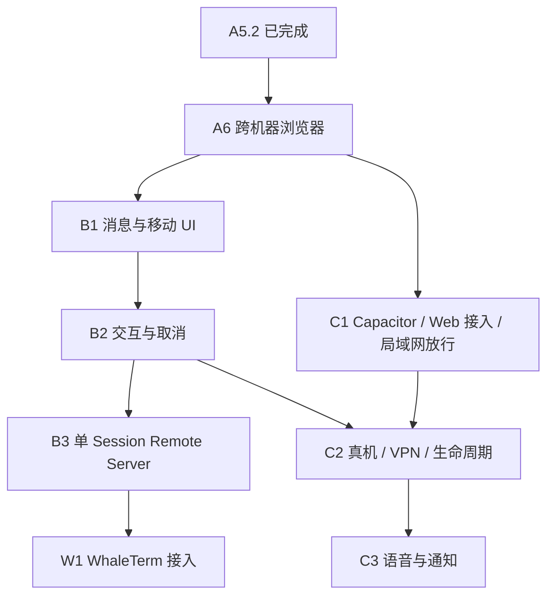

# A5.2 后简化路线与单 Session 远程服务设计

- 日期：2026-08-25
- 修订：2026-08-26
- 状态：已按用户确认的简化方向修订，待完整书面复核
- 前置成果：A1–A5.2 已完成并提交

## 1. 设计结论

后续采用“PC 单 Session 宿主 + 移动端多配对记录”的简单模型：

1. 一个 Standalone CLI 进程只创建或恢复一个 Claude Session；
2. 一个 Remote Server 只服务这个 Session，允许多台手机平等连接和发送操作；
3. 少量并行 Session 通过启动多个 CLI 进程并配置不同端口解决；
4. 移动端可以保存多个已扫描 Session，进入一个 Session 对话后可返回列表并切换；首期一次只连接当前进入的 Session；
5. WhaleTerm 后续为其已持有的一个 Claude Session 在进程内启动 Remote Server，不创建第二个 SDK Client；
6. Pair Token 默认覆盖典型远程接力窗口，客户端可在有效期内重连；Remote Server 重启后重新扫码；
7. 后期公网访问采用“每个 CLI 一条可信 Relay 出站隧道”，不建设 PC 多 Session daemon 或云端会话中心。

不建设常驻多 Session daemon、Local Control API、跨进程 Runtime Registry、PC Claude TUI、持久 device grant 或 remote journal。

## 2. 单 Session 所有权模型

每个活跃 Claude Session 同一时刻只有一个所有者和一个 SDK Client：

- Standalone 模式由启动它的 CLI 持有；
- WhaleTerm 模式由 WhaleTerm 已有的 Claude manager/client 持有；
- Remote Server 只转发 snapshot、事件和操作，不直接调用 Claude SDK；
- JSONL 只可用于定位历史 `sessionId`，不能接管活跃 Session 或充当事件总线；
- 禁止对仍活跃的 Session 再启动一个 `--resume` Client。

```text
Claude Session 所有者（CLI 或 WhaleTerm）
├── 唯一 SDK Client
├── Session Controller / 宿主输入队列
└── Remote Server（只绑定当前 sessionId）
    ├── Pairing
    ├── Session Channel
    └── WebSocket Transport
```

Remote Server 不提供 Session 列表、跨 Session 路由或统一管理接口。当前内部 `Channel Registry` 可以作为实现细节继续保留，但产品组合层只注册一个 Session，不为单 Session 约束做无收益重构。

多个客户端订阅同一 Session Channel 时地位相同：文本输入统一进入宿主队列，由 Session Controller 按实际接受顺序形成 FIFO；不增加手机主从、设备锁或客户端时钟排序。

### 2.1 Standalone CLI

Standalone CLI 创建或恢复一个 Session，启动对应 Remote Server 并输出配对信息。现有 stdin 可继续作为 PC 输入和调试入口，但不扩展 Markdown、Tool 卡片、审批 UI、编辑器或多 Session 面板。

低频并行 Session 直接启动多个 CLI 进程，各自配置 `listen` 和 `advertise-url`。不增加自动端口协调、跨进程列表、共享授权数据库或统一停止命令。

### 2.2 WhaleTerm 接入

WhaleTerm 的 Claude Session 页面后续增加“远程控制”入口：

1. 取得当前真实 `sessionId`；
2. 将现有 snapshot、输入队列、权限回调和类型化事件适配给 Remote Server；
3. 在 WhaleTerm 进程内启动只对应当前 Session 的 Remote Server；
4. 关闭远程控制时只停止 Remote Server，不停止 Claude Session。

B3 再定义最小公共 Go 接口并把现有远程组合包装为可导入组件；现在不提前确定 Go 签名。W1 首期只支持一个 Claude Session 开启远程控制，不设计共享 endpoint、多份 Pair Token 或多 Session Registry。

## 3. 移动端多 Session 配对列表

移动端多 Session 与 PC 单 Session 进程模型互不冲突。每次扫描只增加或更新一个独立配对记录：

```text
CLI A → Session A → Pairing A ┐
CLI B → Session B → Pairing B ├→ 移动端已配对 Session 列表
CLI C → Session C → Pairing C ┘
```

### 3.1 列表行为

- 以 `sessionId` 作为逻辑身份；重新扫描同一 Session 时更新其 `wsUrl`、Pair Token 和有效期；
- 列表展示本地名称、连接地址摘要、最后连接时间以及可连接、已连接、离线或需要重新扫码等状态；
- 进入 Session 时才建立该 Session 的 WebSocket；返回列表时关闭连接，不影响 PC 上的 Claude Session；
- 再次进入时使用仍有效的凭证重新认证并取得最新 snapshot；
- 一次只保持当前进入的 Session 连接，不为列表内所有 Session 维护后台 WebSocket；
- 切换期间不做事件 replay，未连接期间仍遵守“只恢复最新 snapshot、不恢复完整消息历史”的边界；
- 删除列表项只清理本机记录，不撤销服务端共享 Pair Token，避免影响其他已配对客户端。

### 3.2 本地保存与安全

原生 App 重启后保留已扫描列表，并在 Pair Token 未过期时允许直接重连：

- iOS / Android 使用系统安全存储保存 Pair Token，普通元数据可保存于本地应用存储；
- HarmonyOS NEXT 使用等价的系统安全存储；
- 浏览器阶段继续使用当前 Fragment / 内存模型，不把 Pair Token 写入 `localStorage`；
- Pair Token 过期、被撤销，或 Remote Server 重启后认证失败时，保留列表元数据并标记“需要重新扫码”；
- 本地列表不是长期 device grant，也不是服务器端 Session 管理中心。

B1 设计列表与对话详情的共享 UI；C1 创建 Capacitor 壳、接入 Web UI 并放行局域网明文；C2 接入原生扫码和安全存储，并在真机上验证持久化、切换和失效行为。

## 4. 配对与重连

保留当前配对负载：

```text
version / wsUrl / sessionId / pairToken / expiresAt
```

Pair Token 规则：

- 256-bit 安全随机值，默认有效期由 10 分钟调整为 12 小时，用于覆盖典型远程接力窗口；可用 `--pair-token-ttl` 收紧；
- 精确绑定当前 Remote Server 的 `sessionId`；
- 在 WebSocket 首条 `hello` 中提交，不放入 URL query；
- 有效期内可由多个客户端重复认证并重取最新 snapshot；
- 自然过期只拒绝新认证，不主动断开已认证连接；
- 撤销或 Remote Server 停止时立即失效并关闭相关连接；
- 不写入普通日志、文档、测试快照或 Git。

12 小时不保证覆盖任意长度的 Claude Session。凭证过期或 Remote Server 重启后重新扫码，不因此增加设备身份、续期协议、持久授权或事件回放。

## 5. A6：局域网跨机器浏览器联调

A6 在移动测试机到位前只验证跨机器网络闭环：

- 机器 A 运行 Standalone CLI、Claude Session 和 Remote Server；
- Windows 机器 B 从仓库下载工程，只在 `apps/mobile` 执行 `npm ci` 并启动 Vite，在 B 本机打开 `http://localhost:5173`；
- B 浏览器粘贴 A 输出的配对负载，并连接其中的 `wsUrl`；
- A 显式使用 `--listen 0.0.0.0:8765` 和 `--advertise-url ws://<A-LAN-IP>:8765/ws`；
- B 页面 Origin 仍为 `http://localhost:5173`，当前默认 allowlist 已支持；只有通过 B 的 IP 打开 Vite 页面时才增加对应 Origin；
- 默认配置继续只监听 loopback，不自动探测局域网 IP。

A6 门禁覆盖首轮前配对、双向文本和来源同步、多入口 FIFO、鉴权隔离、Pair Token 有效期内重连以及显式 LAN 暴露。Windows 防火墙等环境问题使用操作说明和清晰错误定位，不建设网络诊断子系统。

A6 不宣称手机或 VPN 已验证。手机浏览器、Capacitor、局域网/VPN 和移动生命周期统一在 C2 真机验证。

## 6. 后续阶段

### B1：消息与移动 UI

- Markdown、代码块、Thinking、Tool 调用与结果；
- Session/Turn/来源状态和错误态；
- 已配对 Session 列表与对话详情导航；
- 竞品图片槽位及借鉴说明；
- 不实现审批、AskUserQuestion 或取消。

### B2：交互操作与取消

- Tool 权限审批；
- AskUserQuestion 的单选、多选、自由文本和一次回调中的多问题；
- 取消当前 Turn 和按 request ID 取消排队输入；
- 多入口同时回答时第一位合法解决者成功，其余返回 `stale_action`；
- 具体 payload、SDK 映射和 callback 生命周期在 B2 分阶段设计中确定。

### B3：单 Session Remote Server 组件化

- 将现有 Pairing、Channel 和 Transport 组合为单 Session Remote Server；
- 定义宿主所需的薄接口；
- Standalone CLI 通过该组件启动远程服务；
- 提供 WhaleTerm 可导入的公共 Go 边界；
- 明确停止 Remote Server 不等于停止 Claude Session。

B3 不实现多 Runtime Registry、统一 daemon、Control API、持久授权、Journal 或跨 Session 管理。

### C、W 与 D

- C1 在 A6 后与 B 并行：创建 Capacitor iOS/Android 工程、接入 Web UI 和局域网明文放行；
- W1 在 B3 后：WhaleTerm 接入单 Session Remote Server；
- C2 依赖 C1 和 B2：真机扫码、多配对列表、局域网/VPN、权限交互、前后台切换和有效期内重连；
- C3 在 C2 后实现语音和系统通知；
- HarmonyOS NEXT 按相同协议、配对和验收契约独立实现。



不存在 B4 持久授权/Journal 阶段，也不存在 PC 终端产品化阶段。每个子阶段仍单独完成设计、用户复核、实施计划和门禁。

## 7. 后期公网 Relay

公网中转采用可信转发层，并保持每个 CLI 只对应一个 Session：

```text
CLI A / Session A ──出站 WSS──> Relay ──WSS──> 手机
CLI B / Session B ──出站 WSS──> Relay ──WSS──> 手机
```

- 每个 CLI 独立建立一条出站隧道，Relay 只维护易失的 `routeId → CLI tunnel`；
- Relay 返回的公网 `wss://` 地址直接写入现有配对负载的 `wsUrl`，不增加协议字段；
- 移动端可在同一配对列表中混合保存 LAN/VPN 地址和 Relay 地址；
- CLI 到 Relay 的宿主凭证与手机到 Session 的 Pair Token 分离；
- Pair Token 仍由对应 Session 宿主验证，Relay 不获得 Claude 控制权；
- Relay 可以转发并看到协议流量，但不存储消息、snapshot、Claude 上下文或 Session 历史；
- CLI 或隧道重启后旧 route 和 Pair Token 失效，用户重新扫码；首版不提供永久公网地址或跨重启自动恢复；
- 不建设 PC 聚合 daemon、云端 Session 列表、云端状态机、历史回放或账号驱动的多 Session 管理平台。

若后续要求 Relay 无法看到消息内容，需独立设计端到端加密并按三端共用契约变更流程处理；当前阶段不提前增加公钥字段或加密抽象。

## 8. 三端共用契约

| 契约 | 本设计结论 |
| --- | --- |
| 通信协议 | 保持版本化 JSON envelope、`sessionId`、request ID 和 `seq` |
| 状态模型 | 单 Session snapshot；B2 再增加一个可空 pending action |
| 配对负载 | 保持 `version/wsUrl/sessionId/pairToken/expiresAt` |
| 重连 | Token 有效期内重新认证并取得最新 snapshot，无 replay |
| 多端竞态 | 服务端 FIFO 和第一合法解决者，不依赖客户端时钟 |
| 移动端列表 | 客户端本地能力，不改变服务器协议；原生凭证使用安全存储 |
| Relay | 通过现有 `wsUrl` 切换传输路径，不把云端路由语义写入 Session 协议 |

以上均可由 React Web、Capacitor 和 HarmonyOS NEXT 实现。任何协议字段、状态枚举、配对负载或验收行为变化，仍需先核对三端并记录到 `DECISIONS.md` 后实施。

## 9. 对现有实现的影响

- A2 Host/SDK Client 继续作为 Standalone Session 所有者；
- A3 Controller/FIFO 继续作为单 Session 串行边界；
- A4 Pairing/Channel/Transport 继续使用，不扩展为多 Runtime 管理器；
- A5 Mobile Web 和版本 1 协议继续使用；
- A6 主要使用现有 listen、advertise URL 和 Origin 配置完成跨机器验证；
- B1 增加客户端配对列表和列表/详情导航；
- C2 增加原生扫码、安全存储和多配对切换；C1 只负责 Capacitor 壳、Web 接入和局域网明文放行；
- B3 是唯一必要的结构性抽取，把当前命令目录内的远程组合包装成公共单 Session 组件；
- 公网 Relay 是后期新增传输方式，不反向改变 Session 所有权。

不需要重构 A2–A5.2 的核心链路，也不需要跨 Session 数据库、全局设备中心或 PC 多 Session 服务。

## 10. 明确后置

只有真实使用证明必要时，才重新设计：

- 单进程同时托管多个 Standalone Session；
- 移动端同时维持多个 Session 的后台实时连接；
- 持久 device grant、永久 Relay route 或免扫码恢复；
- remote journal、消息回放或完整历史同步；
- 不可信 Relay 下的端到端加密；
- 多 PC 账号体系、云端 Session 中心、自动地址发现和系统推送。

## 11. 下一步

本设计经用户书面复核后，再同步 `AGENTS.md`、`DECISIONS.md`、`REQUIREMENTS.md`、总体设计、README 和 HANDOFF 的长期路线。关联文档同步完成并再次交用户检查后，才编写 A6 实施计划。
