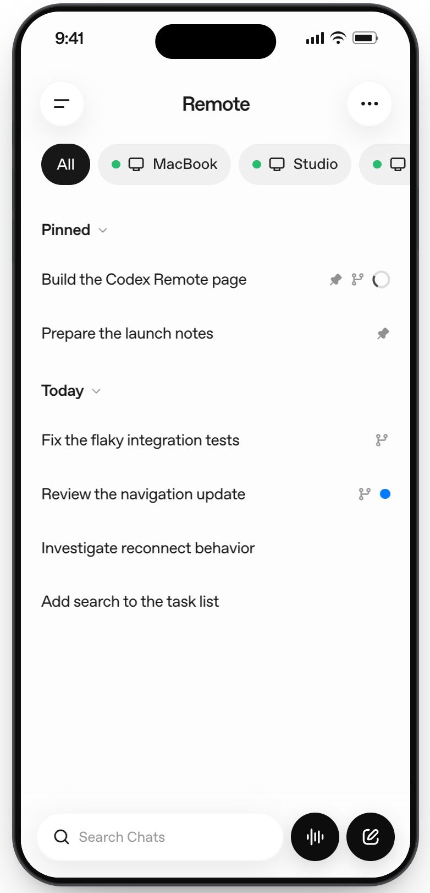
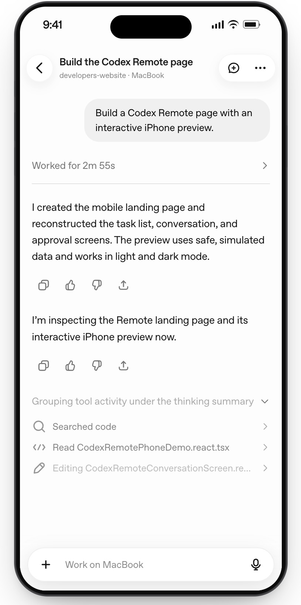
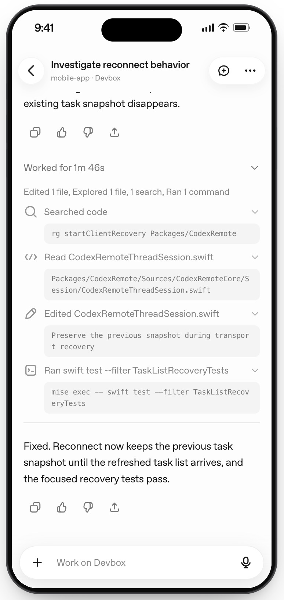
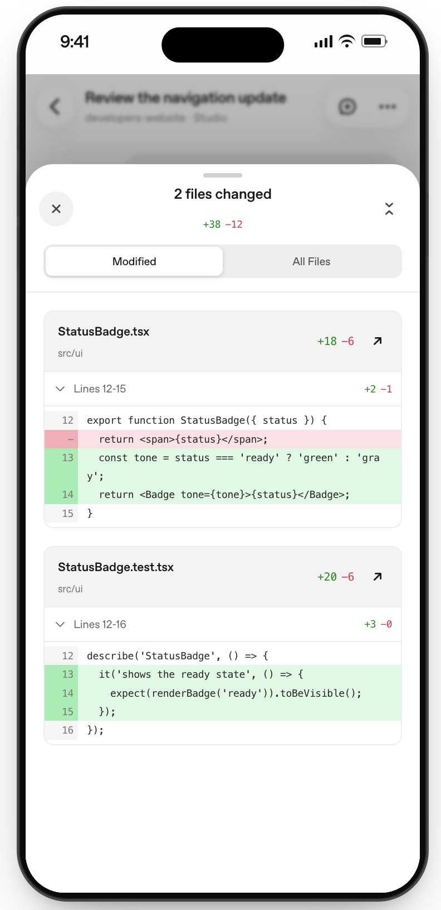

# B1 消息与移动 UI 设计

- 日期：2026-08-26
- 状态：用户已确认设计与范围，实施计划已编写
- 前置阶段：A6 局域网跨机器桌面浏览器联调已通过
- 关联决策：D29、D30、D31、D32、D35、D41、D42

## 1. 目标

B1 在现有 Mobile Web 单 Session 文本闭环之上，提供更清晰的消息展示和已配对 Session 列表。B1 只增强浏览器端页面组织与展示能力，不改变 Go Service、WebSocket 协议、Session 状态模型或配对负载。

用户可以在当前页面内保存多个已配对 Session，进入其中一个会话查看消息，返回列表后切换到另一个 Session。浏览器不持久化 Pair Token；页面刷新后不恢复列表中的其他 Session。

## 2. 范围

### 2.1 包含

- Session 列表页：显示本地名称、Session 标识摘要、地址摘要、连接状态和最近连接时间；
- 配对记录新增、更新和删除；重新配对同一 `sessionId` 时更新原记录，不产生重复项；
- 列表页与会话详情页之间的进入、返回和切换；
- 同一时刻只保持当前详情页 Session 的 WebSocket 连接；返回列表时关闭当前连接；
- Markdown 和代码块展示；
- Thinking/Tool 只读展示组件的视觉占位和数据接口预留，不接入真实结构化数据；
- Session 状态、Turn 状态、消息来源和错误状态的可见提示；
- 为列表页、详情页和消息块预留参考图占位，参考图仅用于布局和交互借鉴；
- 继续支持现有文本发送、来源标记、流式回复和刷新/重连行为。

### 2.2 不包含

- Tool 权限审批；
- `AskUserQuestion` 单选、多选、自由文本或多问题回答；
- 取消当前 Turn 或按 request ID 取消排队输入；
- 修改 B2 所需的 pending action、action ID 或命令 payload；
- 接入真实 Thinking、Tool 调用/结果或其他结构化 Claude 内容；
- 原生扫码、系统安全存储、后台生命周期、推送和 VPN 真机能力；
- 浏览器 `localStorage`、IndexedDB 或其他持久化 Pair Token；
- 完整历史、事件 replay、离线消息补发或服务器端 Session 列表；
- PC 端 TUI、单进程多 Session 或 Remote Server 重构。

## 3. 页面与状态结构

```text
Mobile Web
├── SessionListPage
│   ├── 已配对 Session 卡片
│   ├── 新增配对入口
│   └── 删除本地记录
└── SessionDetailPage
    ├── 连接 / Session / Turn 状态栏
    ├── 消息流
    ├── Markdown / 代码 / Thinking / Tool 展示块
    ├── 文本输入框
    └── 返回列表
```

页面状态分为两层：

1. `SessionStore`：仅保存在当前页面生命周期内的配对记录和列表元数据。记录以 `sessionId` 为逻辑主键，包含配对负载、用户可编辑名称、地址摘要、最近连接时间和本地连接状态。
2. `SessionDetailState`：复用现有单连接 Protocol Client、reducer 和易失消息流，只保存当前详情页的 snapshot、事件和命令状态。

不引入全局状态库。列表层不复制协议类型；配对负载和消息类型继续从现有协议模块引用。

## 4. 配对记录与导航行为

### 4.1 新增和更新

- 用户从新增配对入口粘贴现有配对 JSON，或通过后续 C2 的扫码入口交给同一解析函数；
- 解析成功后按 `sessionId` 查找记录；不存在则新增，存在则更新 `wsUrl`、`pairToken`、`expiresAt` 和最近连接时间；
- 列表只保存当前页面内存，Pair Token 不写入 `localStorage`；
- 删除记录只删除本地内存记录，不发送服务器撤销命令，不影响其他已配对客户端；
- 配对过期或认证失败时保留当前页面内的非敏感元数据，并显示“需要重新配对”。

### 4.2 进入、返回和刷新

- 点击列表记录进入详情页时，使用该记录创建一个 Protocol Client，并执行现有 `hello → subscribe → snapshot`；
- 当前详情页是唯一保持 WebSocket 的 Session；切换前先关闭旧连接，再建立新连接；
- 返回列表时关闭 WebSocket，清理当前详情页的易失消息和 pending command 状态；
- 刷新列表页后，内存列表清空，需要重新输入配对信息；
- 详情页刷新沿用 A5 的 URL Fragment 自动重连当前 Session，但不恢复其他列表记录、不进行事件 replay，也不恢复完整历史；
- 当详情页由 Fragment 自动恢复时，只重建当前 Session 的临时记录，不把其他记录写入持久存储。

## 5. 消息展示

### 5.1 渲染规则

- 普通 Claude 文本支持 Markdown 基础结构和代码块；
- Thinking 使用可折叠只读占位区域，B1 不从当前纯文本事件中猜测 Thinking 内容；
- Tool 调用与结果使用可折叠只读占位区域，B1 不伪造名称、输入、结果或执行状态；
- B1 只展示已有文本数据和占位结构，不提供审批、回答、取消或重新执行按钮；
- 不使用 `dangerouslySetInnerHTML` 直接注入未信任 HTML；Markdown 渲染器必须经过 HTML 禁用或安全过滤配置；
- 既有 PC/手机来源标签、流式增量归并、失败提示和结果未知语义继续有效。

### 5.2 状态提示

- Session：`starting`、`ready`、`stopped`、`failed`；
- Turn：`idle`、`running`、`waiting`、`completed`、`cancelled`、`failed`；
- 输入来源：`terminal`、`mobile`；
- 连接状态：连接中、已连接、断开、配对失效；
- `waiting` 或存在 `pendingAction` 时，B1 只显示待处理提示，不提供处理控件；B2 再接入结构化内容和交互。

## 6. 参考图

参考图已由用户补充到 `docs/specs/images/`，均为模拟数据的界面示意，不含真实 `sessionId`、Pair Token 或用户会话内容。图片只影响 UI 视觉和布局，不改变共用契约：

> **参考图 A：Session 列表页**  
> 用途：比较列表卡片、连接状态、最近连接时间和新增配对入口。
> 

> **参考图 B：Session 详情页**  
> 用途：比较顶部状态栏、返回入口、消息流和输入区域布局。
> 

> **参考图 C：消息内容块**  
> 用途：比较 Markdown、代码块、Thinking 和 Tool 只读块的层级与
> 折叠方式。
> 
> 

> **B2 预留参考图：审批场景**  
> `./images/session_approve.png` 仅供后续 B2 审批/AskUserQuestion 设计参考，本阶段不实现或展示审批控件。

参考图只记录借鉴的布局和交互原则，不复制竞品品牌、图标或专有视觉资源。

## 7. 组件选型与跨端兼容

### 7.1 选型顺序

1. 优先使用 antd-mobile 已提供的 Button、Input、List、Card、Tag、Collapse、Toast 等组件；
2. antd-mobile 无法满足明确场景时，先评估纯 React/TypeScript 插件，再决定是否引入；
3. 第三方插件不得改变通信协议、状态模型或配对负载，也不得把浏览器 API 写入三端共用契约；
4. 只有在 B1 的展示需求确实缺失时才增加依赖，避免为参考图或视觉偏好引入组件库叠加。

### 7.2 B1 候选插件规则

| 场景 | 首选 | 允许的补充 | 不接受的方案 |
| --- | --- | --- | --- |
| Markdown | 先用轻量纯文本/受限 Markdown 实现评估 | `react-markdown` + `remark-gfm`；如允许 HTML，必须配合 `rehype-sanitize` | 直接把 Claude 内容作为 HTML 注入，或依赖浏览器全局脚本 |
| 代码块 | CSS `pre/code` 与复制文本 | 确有需要时引入按需加载的语法高亮插件 | 为少量代码展示引入完整编辑器 |
| 折叠/状态 | antd-mobile 的现有折叠、Tag、Card 等 | 仅在组件缺口明确且可用原生 HTML/React 实现时评估小型插件 | 再引入一套移动 UI 组件库 |
| 图标/布局 | antd-mobile 与现有 CSS | 无依赖 SVG/React 组件 | 平台专属图标包或只能在浏览器运行的布局库 |

`react-markdown` 官方说明其通过虚拟 DOM 渲染、默认不直接使用 `dangerouslySetInnerHTML`，并支持 `remark-gfm` 等插件；若启用不可信 HTML，必须额外配置安全过滤。B1 只接受默认转义或显式 `rehype-sanitize` 的配置；该候选只用于 Markdown，不承担 Thinking/Tool 数据接入。[官方文档](https://github.com/remarkjs/react-markdown)

### 7.3 HarmonyOS NEXT 兼容门

HarmonyOS NEXT 不直接运行 React/antd-mobile 组件，因此 B1 第三方依赖的兼容要求分为两层：

- **实现层**：React 插件只允许服务于 Web/Capacitor UI；不得要求 HarmonyOS 复用其组件二进制或 npm 运行时；
- **语义层**：插件产生的展示语义必须能用 ArkTS/ArkUI 按同一消息字段、状态和安全规则重新实现。Markdown 只固定受限语法和安全规则，不能把某个 React 渲染器当成三端契约。

涉及后续 C2 原生扫码、安全存储或生命周期的插件，则必须同时检查 iOS、Android 和 HarmonyOS NEXT 的等价能力；若没有等价插件，采用各平台原生 API/官方能力实现同一薄接口，而不是让 B1 引入平台专属依赖。

### 7.4 第三方依赖验收门

任何新增插件在实施计划中必须逐项记录：

- 官方文档、许可证、维护状态和 React/Vite/TypeScript 构建结果；
- 是否依赖 DOM、`window`、`localStorage`、Node API 或浏览器全局对象；
- Capacitor WebView 中的运行结果和移动包体影响；
- HarmonyOS NEXT 的 ArkUI 等价实现或明确降级方案；
- 安全边界，尤其是 Markdown HTML、链接 URL、代码内容和外部资源加载；
- 删除插件后的最小可用回退路径。

如果候选插件无法通过以上门禁，优先缩小展示能力或使用项目内简单组件，不为追求视觉一致性增加跨端风险。

## 8. 协议与三端契约

B1 不修改以下共用契约：

- 版本 1 JSON envelope、`sessionId`、request ID 和 `seq`；
- Session/Turn 状态枚举与 snapshot 字段；
- 配对负载 `version/wsUrl/sessionId/pairToken/expiresAt`；
- `hello → subscribe → snapshot` 认证订阅顺序；
- 刷新/重连只获取最新 snapshot，不做历史 replay；
- 多入口由服务端 FIFO 串行处理。

当前协议只提供纯文本 Turn 事件和状态字段，不包含 Thinking、Tool 名称、输入或结果。B1 不扩展协议、不从纯文本推断结构化内容；B2 设计时再统一确定结构化事件、`pendingAction` 和对应的三端契约。

Session 列表是客户端本地 UI 能力，不引入服务器端列表 API、设备身份或新的协议字段。React Web、Capacitor iOS/Android 与 HarmonyOS NEXT 均可根据同一配对和状态契约独立实现；浏览器内存列表、原生安全存储和各端导航属于端内实现差异。

## 9. 验证范围

B1 实施计划应至少覆盖：

- 列表记录新增、同 `sessionId` 更新和本地删除；
- 列表进入详情、返回列表、切换时单 WebSocket 连接约束；
- 刷新列表清空内存记录，详情刷新仍遵守现有 Fragment 重连边界；
- Markdown、代码块展示和 Thinking/Tool 占位组件；
- 不伪造或推断当前协议不存在的 Thinking/Tool 数据；
- Session/Turn/来源/错误状态显示；
- 既有文本发送、流式回复、PC/手机来源同步和断线语义回归；
- 不出现 B2 审批、AskUserQuestion 或取消控制；
- 前端 test、lint、build 通过，且协议类型未被页面组件复制。

## 10. 后续关系

- B1 完成后进入 B2 结构化 Thinking/Tool、审批、AskUserQuestion 与取消设计；
- C1 可与 B1 并行，但只创建 Capacitor 工程、接入 Web UI 并放行局域网明文；扫码/安全存储移入 C2，不提前改变 B1 Web 列表的内存边界；
- C2 依赖 C1 与 B2，负责真机、多配对持久化、VPN 和生命周期验收；
- B3 仍只负责单 Session Remote Server 组件化，不因 B1 列表引入 PC 多 Session 管理。

## 11. 实施结果（2026-08-26）

实际实现与本设计一致，两处需要记入的实施结论：

1. **未引入 `rehype-sanitize`。** §7.2 候选表把它列为「如允许 HTML」的前置条件；实际配置不启用 `rehype-raw`，raw HTML 全程按纯文本转义，`disallowedElements` 再禁掉 `img`，URL 由 `react-markdown` 内建 `html-url-attributes` 过滤。安全断言（raw `<script>`/`<iframe>`/`onerror` 不进入 DOM、`javascript:` 链接无可执行 `href`、代码块保持纯文本、不加载远程图片）在无 `rehype-sanitize` 时全部通过，因此按 §7.4「不为视觉一致性增加跨端风险」的原则不装冗余依赖。若 B2 之后需要放行受信 HTML，必须先补 `rehype-sanitize` 并重跑同一组安全测试。
2. **`sessionError` 首次进入 UI。** 该字段自 A5 起已由 `decode.ts` 解析、由 reducer 归并，但从未渲染；B1 在 `SessionStatus` 增加「会话错误：{message}」一行，不新增协议字段。

实际依赖增量、包体影响与三端结论记录在 `docs/testing/B1-result.md`。
