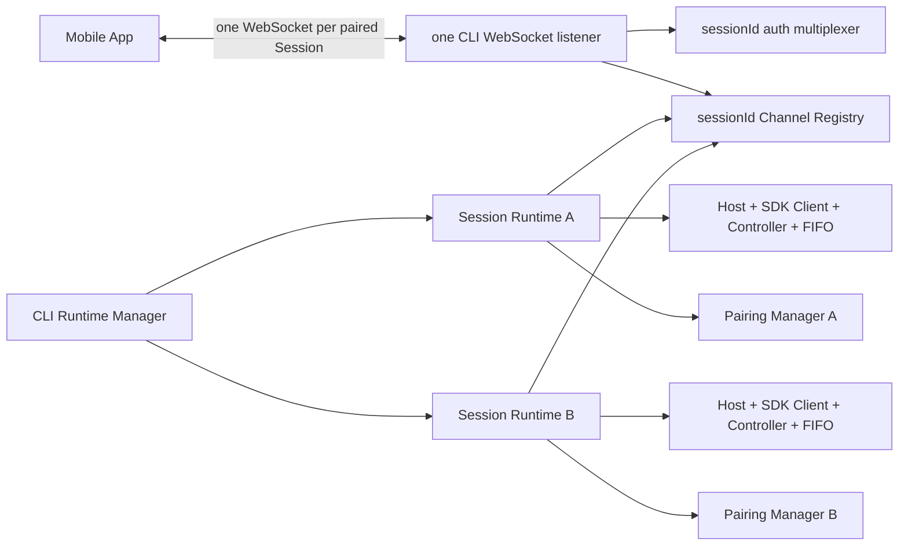

# Standalone CLI 多会话管理设计

- 日期：2026-09-23
- 状态：用户已检查并批准进入实现；创建授权、默认容量与停止后配对入口语义已按 D70/D71 确认
- 已确认需求：保留当前 Claude 会话运行；已配对手机可在同一 CLI 工作目录创建新的独立 Claude 会话；一个 CLI 进程同时管理多个会话。本设计只涉及 Standalone CLI，不涉及 WhaleTerm。

## 1. 目标与非目标

CLI 从单会话组合层升级为多会话 Runtime Manager。每个活跃 Session 仍严格由一个 Host、一个 SDK Client、一个 Controller 和一个输入队列持有；不同 Session 可以并行运行，任何 Session 内的 PC/手机输入仍串行。手机已有的 App 级多配对列表、独立连接与状态分桶继续复用。

首版不读取 Claude 历史列表，不接管外部运行中的 Claude，不把会话上下文移到手机，不让手机选择任意 PC 路径，也不提供账号、跨机器管理、数据库、replay 或后台推送。手机端“删除配对记录”仍只删除本地记录，不等于停止 PC 会话。

## 2. 进程结构

- 一个 CLI 进程监听一组 `--listen` / `--advertise-url`；所有该进程内 Session 的配对负载共享 `wsUrl`，但各自拥有不同 `sessionId`、Pair Token、持久化文件和 Channel。现有公共 `remote.Server` 保持单 Session 组件，CLI 侧组合复用 Channel/Transport/Pairing 基础件，不将公共组件改成隐藏的多 Session Server。跨重启恢复已有 Token 时，CLI 仍给本次展示的 Pairing 补上当前能力字段；能力字段不参与 Token 密钥材料或历史 pairing 文件读取。
- CLI 启动时沿用当前行为：创建或 `--resume` 一个初始 Session，连接 SDK，签发首张二维码；成功配对后手机才可请求创建更多 Session。新 Session 均为全新上下文，使用预分配真实 UUID 和同一 SDK 创建路径；绝不对仍活跃的旧 Session 启动第二个 `--resume` Client。
- 启动时把有效工作目录解析成绝对路径并固定到 Manager。显式 `--cwd` 用该目录，否则用启动瞬间的 `os.Getwd()`；所有手机创建的 Session 使用该固定目录。手机请求没有路径参数。
- Runtime Manager 按 `sessionId` 管理创建中、就绪、停止中、已停止/失败的会话。新建先预留容量和 ID，再启动 Host/Controller、注册 Channel、签发凭证，全部成功后才返回可用配对；失败回滚已创建资源。启动和停止一个 Session 不影响其他 Session。
- 会话上限可显式配置，默认四个活跃会话；创建中和停止中计入，已停止/失败不计入。上限避免一枚被窃取的有效配对凭证无限启动 Claude 进程。

## 3. 授权与协议

已有 Pair Token 继续只认证其 `sessionId`，不能读取、发送命令或停止其他 Session。新增“创建新 Session”是该配对客户端的显式附加权限：仅在 `hello`、`subscribe` 成功后接受，不需要也不允许客户端提供目标路径、目标 Session ID 或凭证。任意有效配对客户端均可创建，因此扫码并持有一个 Session 凭证的设备也获得本 CLI 的创建能力；用户已确认该权限扩大（D70）。

建议保持 wire protocol v2，在该版本中增加与普通 Turn 命令分开的可选管理消息。CLI 签发的 Pairing 增加可选的纯数据 `capabilities: ["create_session", "stop_session"]`；不带能力字段的旧配对记录继续按原协议使用，移动端也不展示新建/停止入口。现有客户端只会收到自己请求的管理结果，不会收到未认识的新广播类型，因此不用强制旧客户端迁移；新客户端必须在解析配对时保留并校验能力字段。能力字段只控制 UI，服务端仍以已认证的 Session、连接状态和当前能力配置做最终鉴权。

| 消息 | 方向 | 核心字段 |
| --- | --- | --- |
| `create_session` | 客户端 → CLI | 当前已认证 `sessionId`、`commandId`；空 payload |
| `create_session_result` | CLI → 客户端 | 原 `sessionId`、`commandId`、`accepted`；成功时为完整新 `Pairing`，失败时为固定 `code/message` |
| `stop_session` | 客户端 → CLI | 当前已认证 `sessionId`、`commandId`；只停止自己对应的 Claude Runtime |
| `stop_session_result` | CLI → 客户端 | 同一 `sessionId`、`commandId`、`accepted/code/message` |

`create_session_result` 的外层 `sessionId` 始终是发起请求的旧 Session；新 `sessionId` 仅在成功结果的 Pairing 中出现。这样请求关联和事件流归属不会串线。创建结果含新 Pair Token，必须沿用现有凭证保密规则：不写日志、测试快照、错误信息或普通消息流；不广播给源 Session 的其他订阅者，只回复发起连接。消息须有长度上限和严格字段校验。新 Session 使用其独立 Token 重新执行 `hello → subscribe`；移动端将新 Pairing 写入现有安全配对容器，再建立新连接并打开新详情。浏览器保持 Fragment/内存规则。Pairing 原有必需字段与版本 1 不变；新增能力字段可选，旧配对负载仍可解析。

创建请求以 `commandId` 做短期幂等：同一认证源 Session、同一 `commandId` 重试返回同一结果，防止响应丢失后重试创建多个 Claude 进程。缓存有界且仅驻 CLI 内存；进程重启后没有活跃 Runtime，PC 可重新创建或 `--resume`。凭证持久化仍按新 `sessionId` 分文件。若服务端完成创建但客户端长期断线，PC CLI 可重新显示该 Session 的配对信息，避免只有手机端持有配对结果。

`stop_session` 只停止当前凭证对应的 Claude Host，保留只读的终态 Snapshot 和该 Session 的认证入口，供已配对客户端查看终态或继续创建新 Session；不得再接受该 Session 的执行命令。若用户希望彻底关闭远程入口和撤销凭证，作为独立的“移除/撤销”操作设计。CLI 进程退出时停止全部 Runtime、关闭连接和监听；每 Session 的持久化凭证文件是否保留沿用现有跨重启策略。

## 4. PC 与手机交互

移动端列表为本机已持有凭证的 Session 列表，不从 CLI 枚举所有 Session，不能因此窥见其他设备创建的 Session。CLI 配对的任意 Session 详情在输入区左下角提供 `+` 新建入口；React/Capacitor 的原附件入口保留，图标改用现有 `document.svg`。无 `create_session` 能力的 WhaleTerm 配对不显示新建入口。新 Session 始终使用 CLI 启动时固定的工作目录，发起详情只决定授权来源，不决定工作目录。创建中防重复点击，成功后添加新 Pairing 并切到新详情，失败显示固定错误码对应的提示。移动端暂时隐藏“终止此会话”入口（包括 CLI 配对）；`stop_session` 协议、PC 终端能力及停止后保留配对/终态的语义不变，WhaleTerm 配对不显示此入口。已停止/失败 Session 仍在原列表中，可查看终态并从详情继续创建。其他 Session 连接和状态不受影响。

PC 终端需能选择目标 Session 发送输入和查看其简短状态，至少提供会话列表、切换当前输出/输入目标、新建和停止命令。原有普通行输入继续发往当前选中的 Session，不能同时写多个 Controller；所有管理命令与普通文本明确区分，避免误把用户 prompt 当作管理命令。终端 EOF 与进程 SIGINT/SIGTERM 的行为须覆盖全部 Runtime，并保证关闭过程有界。

## 5. 失败与安全边界

- 新建失败（容量、UUID、SDK Connect、Channel 注册、凭证、网络）必须原子回滚，旧 Session 不受影响；错误响应不包含路径、token 或 Claude 内部内容。
- 一个 Session 的 SDK 崩溃、Turn 失败、权限等待或慢客户端不停止其他 Session；`seq`、request ID、pending action 和权限模式均按 Session 隔离。
- 同一 CLI 多会话共享工作目录，因此可以同时改动同一批文件。CLI 不隐式锁住文件或自动创建 Git worktree；移动端应提示并行编辑冲突风险，具体冲突处理仍由用户/Claude 决定。
- 局域网/VPN 直连及现有 Origin、Token 校验保持；新增创建能力提高了凭证被滥用时的资源影响，因此上限、限流和明确的创建失败信息属于首版门禁。
- 若创建响应在新 Session 已就绪后丢失，幂等重试与 PC 重新显示配对为恢复路径；不通过旧 Session 的普通事件广播新 Token。

## 6. 三端共用契约核对（设计草案）

新消息都是 JSON envelope、字符串、布尔和对象，Pairing 的可选能力字段是字符串数组；不依赖 DOM、Capacitor、浏览器存储或 SDK 私有协议。React Web/Capacitor 可复用现有 `SessionRuntimeManager`，HarmonyOS NEXT 可用独立 WebSocket/状态容器实现相同请求与结果语义。三端需扩展 Pairing 解析、管理消息解码和 UI；旧 v2 会话不发送新消息时仍按原行为工作。正式决策生效前在 `DECISIONS.md` 记录最终核对结论。各端用同一组创建、幂等、授权、隔离和停止验收用例。

## 7. 人工验收

1. 从指定 `pwd` 启动 CLI，扫码连接 A；手机点击新建得到 B，A 正在运行时仍持续接收事件，B 第一条消息可由手机发送，两个会话工作目录相同。
2. A/B 交错发送文本、审批与取消，`sessionId`、事件、请求与权限模式互不串线；切换手机详情不关闭另一连接。
3. 只停止 B 后 A 保持运行；B 终态可见但拒绝新输入；B 配对凭证不能访问 A。
4. 断线重试同一创建请求不生成第三个 Session；达到容量上限时返回安全错误，旧 Session 不变。
5. CLI 退出时所有 Host 和连接关闭；重启后按现有 `--resume`/凭证文件语义验证恢复边界。不得在日志、文档或测试结果中出现真实 Token 或会话正文。
