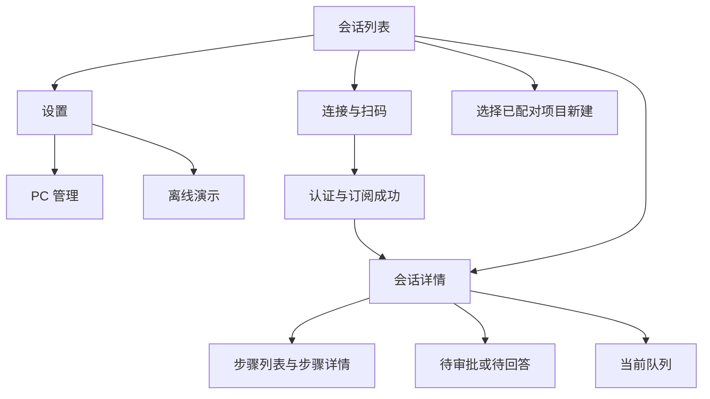

# 新版移动端 UI 改造设计方案

- 日期：2026-11-03
- 状态：用户已确认；2026-11-03 明确底部“新会话”为新增配对、目录 + 为同目录新建，缺少的图标预留空白，后续由用户提供。对应 D111。
- 设计依据：`docs/testing/images/11-03-2/` 六张 PNG。
- 实施顺序：iOS 优先验证，随后完成 Android 平台验证和 HarmonyOS NEXT 独立 UI 同步。
- 配套实施计划：`../plans/2026-11-03-mobile-ui-redesign-ui1-plan.md`。

## 1. 目标与现有基线

将现有移动端改为设计稿中的浅灰蓝背景、白色大圆角卡片、蓝色主操作、清晰的会话分层与底部输入区。改造覆盖页面结构、组件呈现、交互反馈和原生适配，不能只替换颜色和圆角。

现有功能已包括本地多 PC/多配对 Session、App 前台多连接、配对认证订阅、项目及标题信息、消息流、Markdown、工具步骤、审批与问答、附件、权限模式、语音草稿、通知、有限缓存及调试。优先复用这些能力，UI 不能绕过 Session Runtime 直接调用 SDK 或建立第二套会话状态。

现有代码中的重要差异：

| 范围 | 当前实现 | 设计稿目标 |
| --- | --- | --- |
| 列表 | PC 名称下平铺 Session，每行显示目录，底部“新增配对” | PC 卡片、项目标题与 +、独立 Session 卡片、固定底部主按钮 |
| 设置 | antd-mobile 分组列表 | 图标入口卡片、独立调试卡、本地保存说明卡、通知主操作 |
| 配对 | 文本框、目标地址说明和普通按钮 | 大标题、演示胶囊、大输入卡片、地址卡片、主次按钮 |
| 详情 | 白色底、浅灰 Claude 气泡、蓝色用户气泡 | 灰蓝底、白色 Claude/答案卡片、蓝色用户气泡、品牌标识 |
| 步骤 | 文本摘要、两级玻璃抽屉 | 时间轴列表、明确标题与操作、白色抽屉及灰色遮罩 |
| 输入区 | 附件/权限/语音/发送/停止，另有队列入口 | 浮起的圆角整体输入卡，统一图标与操作层级 |

既有未完成项独立保留：PC 图片 v8 源码已接通，但真机、正式 WhaleTerm 依赖以及断线/订阅前图片恢复仍有缺口；双向队列及远程引导后置。本方案只承接其展示位置，不能将 UI 完成等同于这些链路完成。

## 2. 六张设计稿逐图分析

所有图片为 786 × 1704 像素。可按约 393 × 852 的逻辑画布分析比例，具体字号和间距是实施起点，需在实际 WebView 上校准。状态栏、灵动岛和 Home 指示条属于系统区域，不绘制到页面中。

### 2.1 图 1：会话列表

从上到下是品牌导航与设置、页面大标题与数量胶囊、PC 信息卡、项目分组、Session 卡片和底部“+ 新会话”。PC 图标使用蓝色块，目录图标及次要信息使用灰蓝色。

Session 卡片包含标题、右上更多操作、摘要、左下连接状态和右下日期。首张卡片使用淡蓝背景、边框及左侧蓝色标记，但图片没有说明它代表未读、选中还是最近查看，需明确语义。建议沿用现有“刚刚查看”的定位，未读另用独立圆点表示。

设计稿的数量为“5 个会话”，画面只露出四张卡片，应解释为总数与可见区域的区别，不将示例数量写死。“AskUserQuestion · 2 条消息”中的消息数口径未定义，建议首版继续使用现有预览文本，不增加易与完整历史混淆的消息统计。

这张图提出了三个结构性变化：PC 卡片箭头、项目分组 +、底部“新会话”。其动作建议见 §4，均须用已有配对与 `create_session` 能力实现。

### 2.2 图 2：设置

顶部圆形返回按钮与居中标题；PC 管理、体验演示各占一张卡；调试开关和说明放在同一卡片；配对与设备、消息与状态组成说明卡；清除缓存单独成行；通知使用浅蓝大按钮及说明。

功能与现有设置大体对应。需要补齐已开启、被系统拒绝、登记失败等通知状态，以及清除缓存的反馈。图中文字只列出每会话 200 项 / 2 MiB 与 30 天，实施仍须保留既有总计 20 MiB 限额及实际平台说明。Harmony 推送当前暂停，不能因复用这张图而展示为可用。

### 2.3 图 3：连接

导航下方是体验演示入口、大标题和说明，随后是多行配对输入、目标 PC 地址和网络提示；底部连接与扫码形成主次层级。

目标地址卡建议为解析结果的只读展示，不作为独立可编辑地址：地址仍来自配对内容，避免正文凭证与目标地址不一致。图片中的地址只作布局示例，页面按实际输入解析。空白时显示“粘贴或扫码后显示目标地址”。

已有“连接→认证→订阅→有效快照→保存配对→进入详情”的成功条件继续适用，不能点击连接就进入列表。连接中、取消、扫码拒绝和失败布局需补齐。

### 2.4 图 4：会话详情（detail2）

导航标题下显示连接、Session 和 Turn 状态；消息区交替使用 Claude 标识、白色答案卡、右侧蓝色用户气泡、来源/受理说明、取消标记、步骤入口与白色回复卡；底部是圆角输入卡。

答案回显由标签改为“问题标题 + 带勾选标记的已选答案”。它是已提交结果，不能再次点击改变答案。待回答问题仍走原有问答抽屉。

步骤入口同时出现白色卡片和轻量文字行，图片没有交代两者规则。建议无正文的独立活动组使用卡片，有正文相邻的活动组使用轻量行；两者复用同一数据和抽屉，不重复显示。

输入工具栏由 +、附件、手掌、语音和蓝色发送组成。结合现有功能，建议手掌继续映射权限模式，+ 继续映射同目录新建；停止与队列虽然未出现在静态图中，仍须提供。

### 2.5 图 5：工具步骤抽屉

会话背景加灰色遮罩；底部白色大圆角抽屉包括短横条、左对齐摘要标题、虫形图标、关闭按钮和分隔线。主体按时间轴展示思考步骤、工具名称、摘要、状态及详情箭头。

抽屉只占部分屏幕，内容多时应内部滚动，并保留两级详情导航。虫形图标没有说明，建议映射到现有脱敏调试面板，不新增原始工具数据导出能力；关闭调试后隐藏该入口。

图片中顶部“Turn 已完成”、消息“已取消”和工具“执行中”混在一起，不能视为真实状态规范。不同历史 Turn 可以有不同终态，但已终止 Turn 中没有返回结果的工具不得持续显示为实时执行中；其展示应结合所属 Turn 状态，标记“已中断”或“结果未收到”，不得伪造成功结果。

### 2.6 图 6：会话详情（detail）

此图与图 4 文件的 SHA-256 相同，确认为同一张图片。因此六份文件实际表达五种独立画面，不据文件名推断额外的详情交互或第二套布局。

## 3. 视觉规范建议

以下是从位图估算的起始值，不是设计源文件的精确标注。三端共享语义和比例，React 使用 CSS 变量，Harmony 在独立主题文件维护对应值。

| 项目 | 建议基准 | 应用 |
| --- | --- | --- |
| 页面背景 | `#F4F6FA`，可配极淡蓝色渐变 | 列表、设置、连接、详情 |
| 卡片 | `#FFFFFF`，描边 `#DFE6F1` | PC、Session、设置、回复 |
| 主蓝色 | 约 `#3376F6` | 主按钮、用户气泡、选中标记 |
| 正文 | 约 `#202938` | 标题及正文 |
| 次要文字 | 约 `#748198` | 摘要、说明、来源 |
| 弱提示 | 约 `#98A5B9` | 占位、时间；小字需检查对比度 |
| 成功/警告/错误 | 绿/琥珀/红，并配文字或图形 | 连接、等待、失败 |
| 页面横向边距 | 24，窄屏可降至 16 | 卡片和内容对齐 |
| 间距 | 4、8、12、16、24、32 | 统一垂直节奏 |
| 卡片圆角 | 18–20 | 列表、设置、内容卡 |
| 输入区圆角 | 24 | 底部整体输入卡 |
| 抽屉顶部圆角 | 26–28 | 步骤与待处理事项 |
| 阴影 | 低透明度冷灰，宽而轻 | 卡片、底部主按钮、输入卡 |
| 字号 | 页面大标题 30–34；导航 17；卡片标题 16；正文 15–16；辅助 12–14 | 使用相对单位并允许系统字号适配 |
| 图标/触点 | 图标约 20–24；可操作区域至少 44 × 44 | 更多、返回、输入工具栏 |

优先使用项目现有 SVG 与 `antd-mobile-icons`，统一线宽和尺寸。没有的图标先预留空白位置，由用户后续补充；操作入口仍须有文字或无障碍名称，确保功能可辨认及操作。不从整张设计图裁切系统状态栏或图标。品牌标题从平台现有配置读取，Android/Harmony 保留已确认的 `Whale Remote Control` 名称。

白色卡片和清晰描边是新版基础，不依赖大面积高强度玻璃模糊。导航可保留轻量半透明效果；低性能设备和不支持模糊的环境使用实色。

首版以设计稿浅色主题为基准。深色完整主题不从这组图片推导；系统处于深色模式时也要保证输入、弹窗、系统能力返回后的文字可读。

## 4. 信息架构与列表交互建议

### 4.1 页面关系

列表、设置与详情只改变视图；所有有效配对仍由 App Runtime 在前台独立连接和同步。PC 筛选或切换详情不停止其他 Session，不产生服务器端全量 Session 列表。

### 4.2 PC 卡片与项目分组

建议列表默认展示所有本地已配对 PC，每个 PC 使用“PC 卡片 → 项目标题 → 会话卡片”的结构；多个 PC 重复同一结构，只有一个时自然对应设计稿。

PC 卡片箭头建议打开本地 PC 筛选器，提供“全部 PC”和各已配对 PC。PC 管理继续位于设置中，负责移除；筛选器只负责浏览。筛选属于本地 UI 状态，不进入协议。数量胶囊显示当前筛选范围的 Session 总数。

PC 副标题显示“已连接 n / 共 m 个会话”或“暂未连接”，由各 Session 连接状态聚合。单个已配对 Session 在线不能证明该 PC 所有会话都在线，也不需要新增 PC 探活接口。

项目以同一 PC 下实际 `cwd` 精确分组，名称为末级目录，副标题展示路径。显示缩略路径时不得更改分组键；不能将不同 PC 的同名目录或未知目录合并授权。沿用已有最近有意义活动排序和列表阅读位置稳定逻辑；流式 token、重连不能持续把卡片挪到顶部。

重新显示项目分组替代 D84 的平铺列表呈现方式；分组数据仍复用 D72 及现有 `projectGroups`。见 D111。

### 4.3 会话卡片

- 第一行：稳定标题与更多按钮；标题沿用现有自定义名称/宿主标题/回退规则，长标题省略。
- 第二行：最近可见摘要；空会话显示“暂无会话内容”。
- 第三行：连接状态与需要处理的任务提示，右侧为最近有意义活动时间。按设备本地日期展示：跨年显示年月日；本年今天显示时分、昨天显示“昨天”及时分、本周更早日期显示星期几，其余显示月日。一周从周一开始。默认会话标题不拼接创建时间，自定义名称和宿主会话标题保持原样。
- 淡蓝卡片和左侧蓝条建议代表最近查看；未读独立展示；等待审批/回答使用琥珀提示，不能被“已连接”覆盖。
- 更多菜单复用本地重命名及移除配对；移除明确说明电脑上的 Session 继续运行。该行为不同于停止 Claude，不混用文案。

头部品牌导航固定，内容区独立滚动，底部主操作固定并为最后一张卡片预留空间。返回列表保留筛选和滚动位置；原卡片被移除时回到最近有效位置。

### 4.4 “新会话”与项目 +

底部“+ 新会话”直接进入新增配对页面，支持扫描或粘贴配对信息；不弹出新建方式选择面板。

项目 + 直接表达“在此目录新建”，调用该项目中已连接且声明 `create_session` 能力的源 Session。只有一个可用源时直接发起，多个可用源时让用户选择来源 Session；不能推断不同 Remote 具有相同宿主管理权限。无能力、连接不可用、目录未知或请求处理中时禁用并说明原因。

请求成功后沿用现有返回配对信息、存储和打开新 Session 的链路；失败留在原列表，旧 Session 持续运行。前端不通过任意目录字符串向宿主请求创建。

## 5. 设置与连接页面

### 5.1 设置

将现有设置内容移入统一卡片组件，保持说明文字可选中、长文可滚动。PC 管理与离线演示整行可点击，调试开关保留即时生效及进程内有界日志规则。PC 管理子页使用同一视觉规范，复用现有按 PC 移除本机配对能力。

设置及 PC 管理页标题保持固定，内容区域独立滚动，并保留系统安全区。iOS 和 Android 应分别验证原生 WebView 的滚动与安全区；Harmony ArkUI 改版时保持标题位于 Scroll 外并验证设备表现。

“配对与设备”和“消息与状态”说明须按平台真实能力生成：原生端安全存储与有限缓存、浏览器内存保留、缓存不恢复执行态、图片原件不缓存、不支持离线发送。清除缓存只清理展示缓存，保留已配对凭证及当前内存画面，显示成功或失败反馈。

通知按钮至少覆盖“未启用、处理中、已启用、系统未授权、登记失败、平台暂不支持”。授权和服务登记结果分别呈现，不用一个蓝色开关推断后台送达。继续沿用现有前台抑制、最小内容和点击定位规则；Harmony 按当前暂停范围显示真实提示。

### 5.2 连接与扫码

保留原始 JSON 和完整 `#pair` Fragment 两种输入。配对输入框支持粘贴、多行滚动和清空；输入内容及凭证不进入调试日志。解析有效后显示只读目标地址，错误就地显示并保留输入。

连接中显示实际阶段，禁用重复连接和扫码，提供取消；沿用既有建连 8 秒、认证/订阅各 4 秒、总尝试最多 15 秒的规则。取消后忽略旧异步结果，保存安全存储的关键阶段沿用现有门控。认证、订阅、有效快照与保存均完成后进入详情。

首次安装没有返回列表的目标时，不绘制无效返回按钮；有既有配对时可返回。离线演示始终显式标识为模拟，不保存真实配对或消息。扫码权限拒绝、用户取消与无效二维码分别反馈，并保留手动粘贴入口。

连接页在键盘弹出时允许内容滚动，连接与扫码按钮不得遮住输入；大屏按设计稿留白，小屏优先保证可操作区域，不按截图绝对坐标固定高度。

## 6. 会话详情、消息与输入

### 6.1 顶部与状态

固定导航包含返回、稳定会话标题和紧凑状态行。复用已有连接、Session、Turn 三层语义，窄屏可拆为两行。待审批/待回答优先显示；断线时显示断线及重连入口，缓存内容标明“运行状态待连接 PC 确认”，不能沿用绿色实时状态。

Turn 完成后停止计时，Session 仍可继续输入。停止、失败、配对失效分别显示原因和可操作提示。图中的短 Session ID 仅作为无标题时的回退，不能覆盖已有用户命名。

### 6.2 消息呈现

| 类型 | 新版呈现 | 必须保留的行为 |
| --- | --- | --- |
| 用户输入 | 右对齐蓝色圆角气泡，下方来源和受理状态 | 纯文本、附件、正文复制、未知结果提示 |
| Claude 回复 | Claude 标识 + 白色正文卡片 | Markdown、表格/代码横向滚动、原文复制、流式更新 |
| 已提交答案 | 白色问题卡与绿色已选项标记 | 服务端决议回显、支持多选和自定义文本、复制问题与答案 |
| 思考/工具组 | 轻量摘要或独立卡片入口 | 既有块顺序与工具结果关联、打开两级详情 |
| 取消/失败 | 对应 Turn 的文字标记和必要错误 | 区分请求取消与取消生效，不丢弃已生成正文 |

用户气泡最大宽度约 80%，Claude 与答案卡占内容宽度。来源标签使用实际 `terminal/mobile` 及已知受理状态；“已接收”表示宿主受理，不代表模型已完成。不能仅为接近截图给所有 PC 输入补上不存在的确认。

保留文本和问答复制入口，使用低干扰图标或操作栏；长按正文仍可选中，不能为了隐藏装饰图标系统菜单而全局禁用文字选择。图片、代码和卡片内独立点击区域不得误触发送或导航。

PC/手机附件继续使用现有预览数据和占位降级。PC 图片缺失时说明未同步，不尝试读取 PC 文件路径或补取完整历史。近底部自动跟随，上翻阅读时保持当前位置，图片载入和步骤展开不能反复强拉到底。

### 6.3 输入卡与工具栏

输入卡固定在可用视口底部，位于系统安全区之上；上方容纳附件草稿、运行阶段与队列提示。文本区自动增高至既有合理上限后内部滚动，工具栏保持可见。

| 操作 | 建议含义 | 状态要求 |
| --- | --- | --- |
| + | 当前 Session 同目录新建 | 仅宿主声明创建能力时显示，复用既有请求 |
| 附件 | 照片、拍照、文件菜单 | 原生和浏览器按已有能力提供；支持仅附件发送 |
| 手掌 | 权限模式菜单 | 保留真实模式、待权限请求及操作受理反馈 |
| 麦克风 | 语音识别生成可编辑草稿 | 录音中/识别中/错误可辨认，仍需用户手动发送 |
| 蓝色上箭头 | 发送文本或附件 | 空草稿禁用；未受理保留草稿；不自动重发 |
| 停止 | 取消当前 Turn | 运行中空草稿时占主操作位；有草稿时与发送并存 |
| 队列入口 | 展开当前 Session 队列 | 输入卡上方紧凑显示，不挤入五个图标之间 |

输入栏 + 和手掌分别对应同目录新建与权限模式，用户已确认。工具栏在窄屏仍保证触点，必要时将次要操作放入菜单，不缩小到难以点击。

保留中文输入法组合保护、失败提示、附件追加/移除/预览，以及每次最多 4 项、每项 4 MiB、总计 8 MiB 的限制。队列只展示现有可获知内容，未具备实时双向同步时说明当前视图来源；未声明引导能力时隐藏引导，不能因新版入口暗示能力已经完成。

### 6.4 待处理事项

待审批/待回答使用新版白色底部抽屉，保留已有选项、文本回答、单选/多选、复制和提交反馈。它与普通工具步骤抽屉具有不同关闭语义：待处理事项的显式取消/关闭沿用 D53，取消当前 Turn；普通步骤抽屉关闭只收起视图。

不得仅为统一外观共用一个无差别关闭回调。遮罩点击、系统返回和下拉行为以现有事项约束为准，不能静默产生批准或取消；若未来调整 D53，另行确认。多个手机同时处理时，以宿主返回的已解决状态收敛，不重复提交。

## 7. 步骤抽屉与详情

复用 `ActivityGroup` 的列表/详情两级结构及 `BottomDrawer` 容器。更新为白色表面、灰色遮罩、顶部短横条和左对齐标题；短横条首先作为视觉提示，拖拽收起并非本次必须新增的交互。

列表以现有块顺序构建时间轴：步骤类型、首行摘要、工具状态、详情箭头。长摘要单行省略，详情展示现有可公开的思考文本、白名单输入预览和有界工具结果。无内容时保留“未提供可展示内容”，不推导或生成额外思考过程。

详情页保留返回步骤列表、关闭、输入/结果分区、长文本滚动和结果截断说明。列表与详情共用一个抽屉，避免叠加两层遮罩；切换时保持可辨认的方向和焦点。

默认高度按内容增长，最大高度约可用视口的 86%，同时避让顶部安全区；标题固定，主体内部滚动。普通步骤抽屉关闭不取消 Turn。调试入口若采用虫形图标，复用现有脱敏日志并避开多重弹层，关闭后可回到步骤列表。

11-06 视觉修正：步骤列表使用实色状态点及仅连接相邻步骤的实线，去除行分隔线；标题操作包含调试入口和关闭按钮。抽屉打开时全局调试悬浮按钮位于遮罩下，避免与抽屉内入口重叠。

## 8. 组件与三端实施边界

### 8.1 React / Capacitor

| 现有位置 | 改造职责 |
| --- | --- |
| `apps/mobile/src/App.tsx` | 页面壳、列表底部操作、设置卡片布局，减少页面内部行内样式 |
| `components/ui.ts`、`app.css` | 主题变量、字体、卡片、导航和安全区规则 |
| `ProjectSessionList.tsx`、对应 CSS | PC 卡、项目分组、Session 卡、计数与创建回调 |
| `projectGroups.ts`、`pcGroups.ts` | 复用分组和机器名称；新增展示派生逻辑不污染协议 |
| `PairingForm.tsx` | 新版配对表单、地址卡、连接阶段及错误布局 |
| `PCSettings.tsx`、`NotificationSettings.tsx` | 统一卡片样式及实际能力状态 |
| `SessionDetail.tsx`、`SessionStatus.tsx` | 导航、状态、滚动区、输入卡与队列位置 |
| `MessageFeed.tsx`、`MessageMarkdown.tsx` | 消息/答案卡、复制、附件及 Markdown 布局 |
| `MessageComposer.tsx`、对应 CSS | 工具栏、附件草稿、发送/停止和录音反馈 |
| `ActivityGroup.tsx`、`BottomDrawer`、`PendingActionCard.tsx` | 新抽屉外观、步骤时间轴、保留不同操作语义 |
| `PageTransition`、`DebugPanel`、离线演示 | 保留转场/减少动态效果，适配新输入区和展示场景 |

可按实际复杂度提取 PC 卡片、Session 卡片、设置卡片和输入工具按钮等展示组件；不建立重复的 Session Store。页面布局与状态派生分开，便于逐步替换及回归。

iOS 和 Android 共用 React 页面，本轮对共用代码的修改会同时改变 Android Web 资源；“iOS 优先”指优先平台适配及验收，不承诺 Android 保持旧界面。Android 后续阶段需同步资源、核验原生能力并独立验收。

### 8.2 HarmonyOS NEXT

在 `apps/harmony/entry/src/main/ets/ui/styles.ets` 建立等价主题值；列表/设置以 `pages/SessionListPage.ets` 为主，连接以 `pages/PairingPage.ets` 为主，详情以 `pages/SessionPage.ets` 及 `components/MessageList.ets`、`MessageComposer.ets` 等承接。沿用 `AppShell.ets` 的连接、存储和回调归属。

复用现有组件框架实现等价 PC/项目/Session 卡片、步骤时间轴及两级弹层，不复制 React/DOM/CSS 行为。列表键与滚动位置保持稳定，ArkUI 使用系统安全区、窗口和输入法信息适配。后续实施时如需拆分设置页，保留已有存储及通知回调，不重建业务链路。

### 8.3 三端共用契约核对

| 契约 | 本方案影响 | 三端可实现性 |
| --- | --- | --- |
| 通信协议 | 计划复用现有版本、命令、事件及能力字段 | 不增加平台专属消息，按现有协商降级 |
| Session/Turn 状态 | 保留业务状态；增加本地筛选、卡片和抽屉视图状态 | 视图状态三端分别管理，不进入宿主快照 |
| 配对负载 | 保留原始 JSON / Fragment 和 Session 精确授权 | 扫码及粘贴只是入口，认证订阅规则一致 |
| 验收用例 | 新增统一页面/交互场景 | 三端按同一场景验收，系统能力结果分别记录 |

步骤终态提示从已有块所属 Turn 与结果派生；PC 连接摘要从已有 Session 状态派生；不新增远程 PC/历史接口。如果实施核对发现必须改变公共状态或 wire，先补具体设计、取得确认并在 `DECISIONS.md` 记录三端核对后再实施。

## 9. 分期与验收

| 阶段 | 交付 | 通过条件 |
| --- | --- | --- |
| UI-0 方案确认 | 本文具体交互、视觉方向和替代关系 | 用户已检查 §10，决策及 UI-1 实施计划已记录 |
| UI-1 基础与入口 | 主题、导航、列表、PC/项目分组、设置、连接 | 本地假数据可覆盖空/多 PC/长标题/连接失败；现有入口和安全存储行为保持正确 |
| UI-2 详情与输入 | 消息、答案、Markdown、附件、输入工具栏、队列入口 | 发送/停止/权限/语音/复制/滚动不退化，状态及禁用原因真实 |
| UI-3 抽屉与 iOS 验收 | 步骤、详情、审批问答、键盘和生命周期 | 共用自动化与 iOS 构建通过，设计稿对应场景及真实设备体验通过 |
| UI-4 Android 同步 | 同步 Web 资源与原生适配 | Android 构建及平台专项验收，复用 UI-1～3 场景 |
| UI-5 Harmony 同步 | ArkUI 等价页面及交互 | 逻辑检查/官方构建通过，Harmony 真机按相同场景验收 |

实施中复用现有测试并补充新交互：PC 筛选、项目新建来源选择、卡片菜单隔离、返回位置、关闭弹层语义、状态切换及发送/停止并存。共用前端运行 `npm test`、`npm run lint`、`npm run build`；原生编译沿用仓库已有脚本，适用时核验实际包内 Web 资源。只有业务或协议发生变化时再运行相应 Go 回归。

视觉验收使用固定的合成场景和相同视口，避免真实会话正文及配对凭证进入截图。至少覆盖约 393 × 852 基准、小屏、大字号、长文本、键盘弹出与收起；Android 覆盖系统返回和导航栏，Harmony 覆盖系统返回、弹层与输入法。截图比较关注卡片比例、间距、字号、颜色和遮挡，不能用代码测试代替视觉验收。

用户集中验收清单：

1. 列表、设置、连接、详情、步骤抽屉与设计稿风格和层次一致。
2. 多 PC/项目和长列表能正确辨认；返回原位置，未读和最近查看不混淆。
3. 新增配对和项目新建含义清楚，旧会话继续运行；详情不提供新建入口。
4. 问答/审批、正文复制、图片预览、语音、权限、发送及停止正常。
5. 键盘、系统返回和安全区不遮挡，断线/缓存/失败状态准确。

各端实际验证后再保存 `docs/testing/` 记录。当前文档编写不构成新版本构建、真机验收或 PC 图片链路完成。

## 10. 用户确认的交互

| 检查项 | 已确认方案 | 影响 |
| --- | --- | --- |
| 列表层级 | 所有 PC 各自显示 PC 卡和项目分组；箭头打开本地 PC 筛选 | 调整 D84 平铺呈现，继续复用原有本地配对和分组 |
| 底部“新会话” | 直接进入新增配对 | 扫描或粘贴配对信息 |
| 项目 + | 在该项目新建；多个可用来源时选择源 Session | 复用 `create_session`，不开放任意目录 |
| 蓝色卡片标记 | 最近查看；未读独立圆点 | 保留已有返回定位，不混淆任务状态 |
| 输入栏 + / 手掌 | 同目录新建 / 权限模式 | 保留现有功能，停止和队列另补完整状态 |
| 抽屉虫形图标 | 打开已有脱敏调试日志，调试关闭时隐藏 | 不新增原始数据入口 |
| “步骤卡 / 文字行” | 独立活动组用卡片，贴近正文的活动组用轻量行 | 同一组只显示一个入口 |
| 执行顺序 | iOS 优先验收，再做 Android 平台收尾和 Harmony UI 同步 | 共用 React 代码自然影响 Android；三端分别记录验收 |
| 缺少的图标 | 先预留空白位置，用户后续补充 | 维持操作入口的可辨认性与无障碍名称 |

用户已于 2026-11-03 确认以上方案及其余交互；缺少的图标由用户后续补充。后续实施按对应计划和各阶段门禁推进。

## 11. 新增问答与附件设计稿（2026-11-04）

新增三张参考图：

- ：白色圆角抽屉，顶部拖动提示和标题；按问题分组显示蓝色短标题、问题、单选圆形或多选方形选项，选中行浅蓝描边，描述置于选项下。提交按钮位于抽屉底部；问题很多时内容区独立滚动。自由文本和关闭即取消 Turn 的既有语义保持不变。
- ：消息流内使用白色卡片，顶部“你的回答”和已选数量，各问题分别显示标题、问题与蓝色答案标签；答案由服务端决议回显，不能编辑或臆造缺失数据。
- ：输入栏附件按钮上方显示白色菜单，依次为相机、照片和文件，使用新增 SVG；沿用系统选择器、权限处理及附件限制。

此补充仅改变 React 共用 UI，沿用既有问答及附件协议；Android 随共享代码更新并在后续验收，Harmony 依同一视觉及交互语义独立同步。

### 2026-11-04 iPhone 验收反馈

按验收记录修正固定导航、返回图标、单多选形态、录音动效与布局、详情消息及设置样式。目录行展开或收起会话；PC 行打开底部筛选抽屉，可选择全部或指定已配对 PC。新增配对成功且当前选择的 PC 不包含该会话时，切换至新会话所属 PC；不改变共享协议。完整反馈见 `docs/testing/2026-11-04-mobile-ui2-ui3-result.md`。

PC 筛选补充（D117）：首次默认全部电脑，原生端记住用户选择并在重启时恢复；对应 PC 不存在时回退全部。抽屉随内容收缩，列表过长时限高滚动，从抽屉切换全部，不在列表额外显示切换入口。调试开关同样记住用户选择，日志仍只保留在本次运行内存。

修订：无已保存选择或所选电脑删除时，只有一台电脑默认选中它，否则选全部；用户主动选全部需区分未设置并持久化。调试悬浮入口缩小视觉尺寸。
# 目录新建补充（2026-11-04，D113）

目录 + 有可创建来源时直接创建，多个来源保留选择；无已连接会话时进入配对页并提示扫描目标电脑、目标目录的新会话。验证候选配对的 pcId 与订阅快照的完整 projectCwd 后才保存；身份或目录缺失、不匹配时关闭候选连接并以 Toast 提示，允许重试或返回。没有可靠 pcId 的旧记录不能以地址或名称推断机器。已有连接但不可创建、正在处理、目录未知等异常以 Toast 提示。底部新会话保持普通配对。此流程不修改三端共享协议。

2026-11-06 测试反馈修订：多个可用来源自动选择一个直接创建，不再显示来源选择。步骤状态标签使用圆角；附件支持单项删除和输入区底部清除全部；用户消息和 Claude 回复长按默认全选并显示复制操作，允许调整选区；权限菜单去除首项上方分割线并在两侧留白。Android 共用界面随资源更新，Harmony 独立实现等价交互；iOS/Android 原生选择手柄和系统菜单需设备验收。

2026-11-06 第三批反馈：附件缩略图删除符号使用居中的图形，清空全部附件改为权限按钮右侧的图标；预览挂载到全屏容器。附件菜单与权限菜单一致处理分割线。长按复制保留全选和可调整选区，在系统触摸事件清除选区时保留最近一次有效选区，避免误报空选区；设备端选择与菜单交互仍需实际验收。

2026-11-06 第四批反馈：清空附件图标与权限图标视觉尺寸一致；长按选区避免重复切换，选区显示不覆盖输入区；复制菜单位于当前可见消息区域并随滚动及视口变化调整，同时保留全选和调整选区能力。iOS 选区渲染及系统事件需真机验证，Android 与 Harmony 后续验收。

2026-11-06 第五批反馈：长按达到阈值时即全选并显示菜单，替代第四批松手后触发的时机；滚动手势不触发，后续触摸仍可调整原生选区。选区取消、焦点移入输入框、切换窗口或应用进入后台时同步关闭复制菜单并清除旧选区缓存；点击复制保护当前选区。清空附件图标与工具栏同一中心线，权限和附件菜单的行内容居中，保留右侧选中标记及既有分隔线规则。仅调整客户端交互，不改共用契约；设备端事件表现由用户验收。

原生能力审查补充：当前为前端长按/菜单、WebKit 选区与手柄、原生剪贴板的组合；原生触觉反馈可独立接入，不能据其他应用震动推断其渲染架构。本轮没有新增震动插件或更换原生消息渲染；完整原生选区方案需另行评估 Markdown、代码/表格、流式更新和跨端交互。官方依据与待验证项见 11-06 测试记录的原生审查部分。

用户后续确认增加长按成功时的一次原生轻触觉反馈：复用 SessionExperience 可选本地接口，不安装额外插件；仅在触摸长按达到阈值且有效选区建立后触发，松手、拖动选区、滚动取消和桌面右键不触发。iOS 使用系统轻反馈，Android 使用系统长按反馈并尊重系统设置；浏览器、旧版原生壳或反馈失败时不影响选择与复制。Harmony 后续使用等价本地能力独立同步，不引入平台专属通信字段。

统一选区修订（D119，用户确认）：轻震已验收，选区反复切换与系统菜单仍未通过。本次保持原消息卡片和 Markdown，改用独立 Range 度量文字，不调用 Selection.addRange；仅消息正文持续禁用系统文字选择与呼出菜单，组件绘制高亮、开始/结束手柄及复制菜单。长按约 500ms 内完成全选，松手不重选，普通滚动取消待触发长按；拖动手柄按实际字形位置调整边界，支持 Unicode 字素边界。复制读取当前应用选区，失败保留选区可重试；点击外部、输入框聚焦、后台或内容失效清除界面与选区。布局/滚动变化重新测量，所有高亮与手柄裁剪在消息可见区域内，长文本边缘拖动支持滚动。流式内容变化时结束当前选择，避免旧边界对应错误文本。iOS/Android 共享实现，Harmony 后续独立同步；不运行 npm lint/build/test，由用户构建并重点验收代码、表格、长文本与流式更新。

网络切换补充：同 PC 创建响应中的子会话在自动验证连接时使用已连接来源的主机地址及返回的子会话端口和路径，保持协议及身份校验；连接或保存失败用 Toast 告知 PC 可能已创建，不能盲目重复新建。配对页进入设置后返回原配对页、目录目标不丢失，使用返回动画；离开配对页清除本次失败提示。

2026-11-09 队列入口修订（D120）：WhaleTerm 双向队列恢复实施，入口改到输入卡左下方 permission 右侧，支持宿主且非空时才显示数量；点击打开限高队列抽屉，提供来源、预览、取消及可用引导。清空时隐藏，断线禁用操作，异常 Toast；替代上文输入卡上方或空队列入口安排。共享 v8、单一宿主 FIFO、PC 编辑/排序同步及平台范围见队列设计补充。
